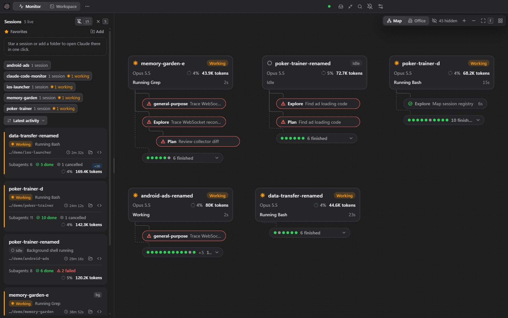
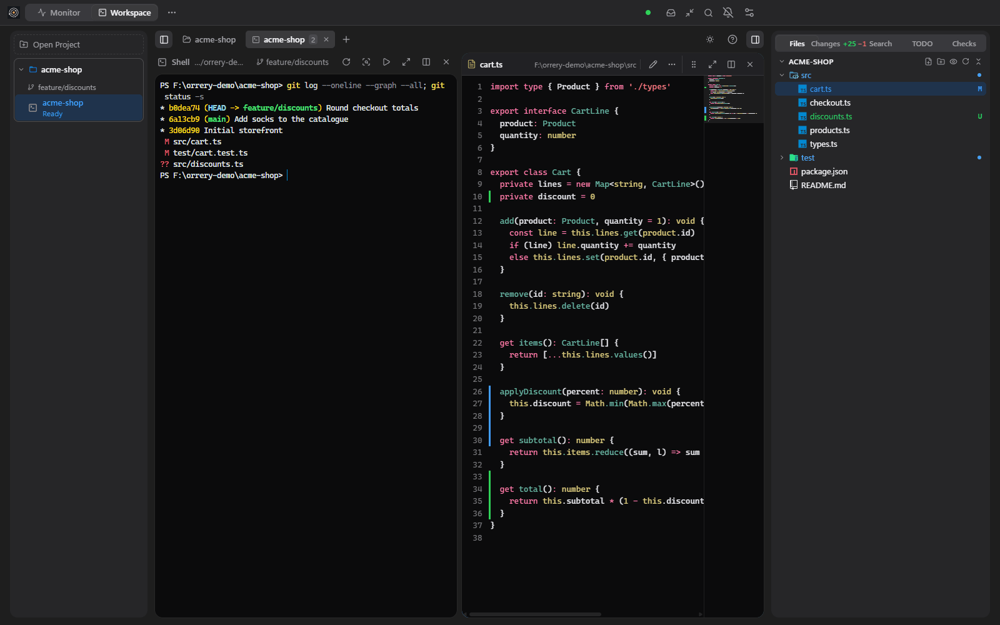
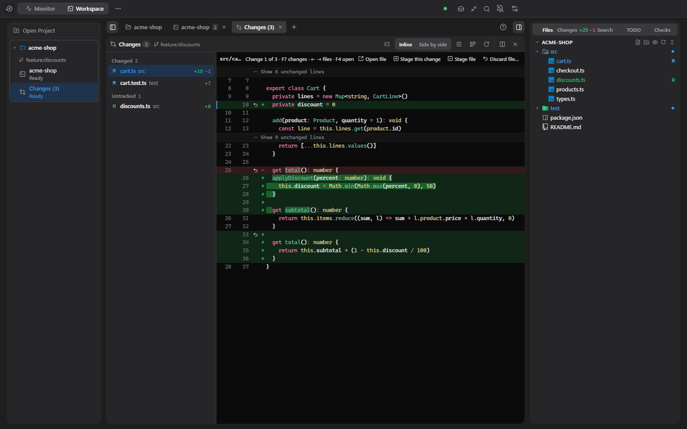
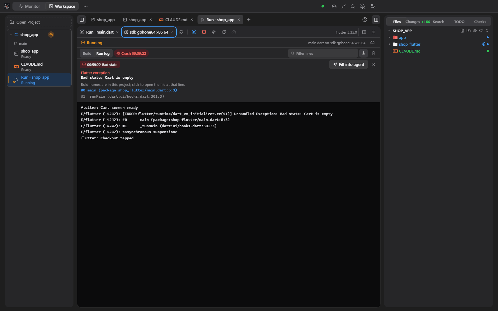
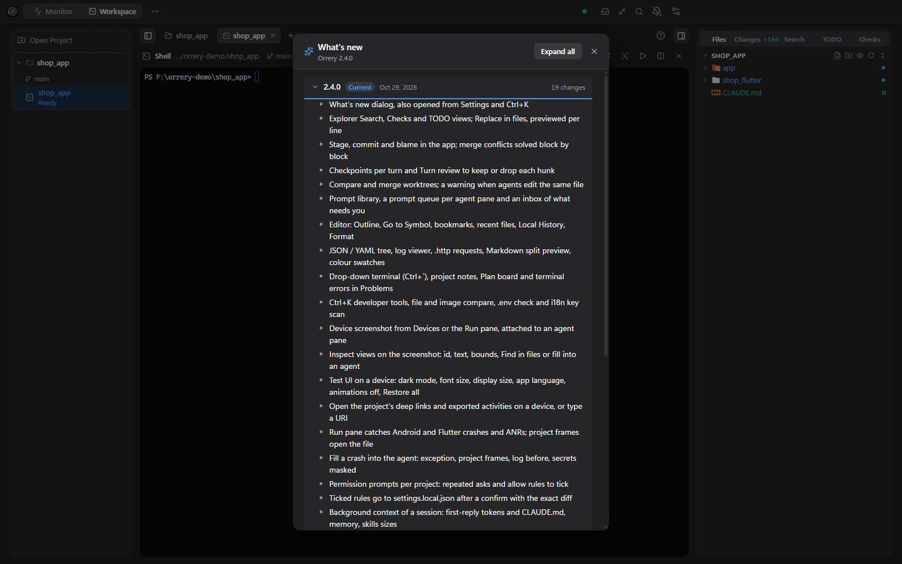

# Orrery

App desktop (Windows, macOS) theo dõi realtime mọi session Claude Code CLI đang chạy, kèm các lần Codex CLI do chúng gọi: session nào đang làm, đang chờ bạn, agent chính và sub-agent đang chạy tool gì, token và chi phí. Có thêm **Workspace**: terminal, editor, Git và Run ngay trong app để làm việc cùng agent mà không phải đổi cửa sổ.

Tên cũ: Claude Code Monitor, Agent Monitor, GolAIm. Mã nội bộ giữ nguyên (`dev.ccm.monitor`, data `ccm`, biến `CCM_*`) nên bản cũ cập nhật thẳng, không mất cài đặt.



| Workspace: terminal, editor, Explorer | Changes: diff, stage từng đoạn |
|---|---|
|  |  |
| **Run pane: bắt crash, điền vào agent** | **Có gì mới trong 2.4.0** |
|  |  |

## Nguyên tắc

- **Chỉ quan sát**: đọc file local của Claude Code / Codex (session, transcript, hook). Không gọi API, không gửi prompt, không chạy LLM khác: **không tốn thêm token**. Ngoại lệ duy nhất do bạn bấm: **Compact…** gửi một prompt bàn giao vào pane agent bạn chọn.
- **Chỉ local**: collector bind `127.0.0.1` và từ chối mọi request không mang khoá của app (trình duyệt mở `127.0.0.1:4317` nhận `403`).
- Không đưa nội dung prompt, tham số tool, env hay secret ra giao diện. Token chỉ hiện khi có số liệu thật.

## Tính năng chính

**Monitor**
- Hàng chờ "Cần bạn", danh sách session (branch, % context, thay đổi chưa commit, nhảy tới đúng terminal, hoãn nhắc), Agent Map main → sub-agent, tin nhắn giữa các agent chính.
- Codex CLI do Claude gọi hiện thành node con dưới đúng agent; chip giới hạn Codex 5h / tuần.
- Office pixel-art (Habblaud): mỗi dự án một phòng, mỗi agent một nhân vật.
- Usage (token, chi phí ước tính, giới hạn gói), History (heatmap theo giờ, recap Markdown); thông báo khi session chờ bạn.

**Workspace và editor**
- Terminal trong app (Claude Code / Codex / shell): tab, chia ô, nhóm tab, phóng ô, hoàn tác đóng, Mission Control, worktree, khôi phục workspace (`--resume`), terminal thả xuống (`` Ctrl+` ``).
- Editor có tô màu cú pháp, tự lưu (tuỳ chọn), Outline, Go to Symbol, bookmark, Local History, Format; cây JSON / YAML, xem log, gửi request `.http`, xem trước Markdown song song.
- Explorer kiểu IntelliJ (icon Atom Material): Tìm kiếm + Thay trong nhiều file, TODO, Checks; pane Trình duyệt cho HTML / `localhost`; ghi chú dự án, Plan board; `Ctrl K` có công cụ dev, so file / ảnh, kiểm `.env`, quét khoá i18n.

**Git**
- Changes: diff kiểu Android Studio (minimap, hai cột), stage / commit, blame, bỏ từng đoạn, giải xung đột theo từng khối.
- Log: đồ thị, nhánh, tạo / fast-forward / fetch / xoá nhánh; push / pull bằng nhiều tài khoản GitHub (token cất trong keychain hệ điều hành).
- Checkpoint theo lượt agent, Xem lượt này để giữ / bỏ từng đoạn; so sánh và gộp worktree.

**Run và thiết bị**
- Run pane cho Android / Flutter: bắt crash và ANR, bấm frame để mở file, **Điền vào agent** (đã che bí mật).
- XML Layout Preview và Flutter Widget Preview.
- Tab Thiết bị: kết nối Android qua USB / Wi-Fi (mã ghép, QR, tự kết nối), chụp màn + soi view, thử UI (giao diện tối, cỡ chữ, ngôn ngữ, tắt animation), mở deep link của dự án.

**Agent và an toàn**
- Thư viện prompt, hàng chờ prompt cho từng pane agent, hộp việc cần bạn, cảnh báo khi các agent cùng sửa một file.
- Hỏi quyền theo dự án: gom các lần hỏi lặp lại, luật allow tích chọn được ghi vào `settings.local.json` sau khi xác nhận đúng phần thay đổi.
- Ngữ cảnh nền của session: token lượt đầu và kích thước CLAUDE.md, memory, skill.
- Agent trong Workspace mở pane mới qua MCP server `orrery` (prompt chỉ điền sẵn, không tự gửi); tab Extensions cài MCP server / plugin qua `claude` CLI sau khi xác nhận.

## Cài đặt

Tải bản mới nhất ở [GitHub Releases](https://github.com/JLSoft-Together/Claude-Code-Monitor/releases).

| Hệ điều hành | File |
|---|---|
| Windows 10 / 11 | `Orrery-Setup-<ver>.exe` (cài đặt) hoặc `Orrery-Portable-<ver>.exe` |
| macOS Apple Silicon / Intel | `Orrery-<ver>-arm64.dmg` / `Orrery-<ver>-x64.dmg` |

Cần Claude Code CLI `2.1.289` (version khác vẫn chạy, có cảnh báo). Không bắt buộc: Git, VS Code. Mở app rồi chạy `claude` ở terminal bất kỳ: session hiện lên trong khoảng 1 giây. Lần đầu app hiện **Thiết lập nhanh** và hướng dẫn (xem lại: `Ctrl K` → "Xem hướng dẫn").

- **Windows**: exe chưa ký số, SmartScreen cảnh báo lần đầu → **More info → Run anyway**. Đóng cửa sổ = ẩn xuống tray, thoát từ menu tray. Có tuỳ chọn Chạy cùng Windows.
- **macOS**: app ký ad-hoc, chưa notarize. Kéo vào **Applications**, mở → bị chặn → **System Settings → Privacy & Security → Open Anyway** (hoặc `xattr -dr com.apple.quarantine "/Applications/Orrery.app"`). Lần đầu nhảy tới terminal, macOS hỏi quyền **Automation** cho Terminal / iTerm2.
- Đã cài bản tên cũ: cài bản mới đè lên (Windows) hoặc xoá `GolAIm.app` / `Agent Monitor.app` / `Claude Code Monitor.app` sau khi chép bản mới (macOS).

### Status line và hook bridge

Claude Code chỉ đưa giới hạn gói và chi phí cho lệnh status line. **Cài đặt → Status line** đưa ra đúng lệnh cần thêm vào `~/.claude/settings.json` (bấm để chép):

```json
{ "statusLine": { "type": "command", "command": "node \"<...>/statusline-bridge.mjs\"" } }
```

Đã có status line riêng thì nối thêm `--chain <lệnh cũ>`. Máy không có `node` thì dùng file `.cmd` / `.sh` chạy chính app (bản Portable luôn cần `node`). Hook bridge (bật trong Thiết lập nhanh) ghi lại lúc compact, tool bị từ chối và các lần hỏi quyền.

## Cấu hình

| Biến | Mặc định | Ý nghĩa |
|---|---|---|
| `CCM_PORT` | `4317` | Port collector (trùng cổng OTLP/gRPC: đang chạy OTel collector thì đổi) |
| `CLAUDE_CONFIG_DIR` | `~/.claude` | Thư mục data Claude Code |
| `CODEX_HOME` / `CCM_CODEX` | `~/.codex` / `1` | Thư mục data Codex; `CCM_CODEX=0` tắt theo dõi Codex |
| `CCM_DATA_DIR` | Windows `%LOCALAPPDATA%/ccm`, macOS `~/Library/Application Support/ccm` | Cache thống kê, tên session, lịch sử |
| `CCM_TOAST` | `1` | `0` = tắt toast / cảnh báo hệ thống |

## Lỗi thường gặp

Mở **Cài đặt → Chẩn đoán** trước; **Lưu file log…** gom phiên bản app, báo cáo và log để gửi kèm.

| Hiện tượng | Cách xử lý |
|---|---|
| App báo cổng bận | Bản cũ chạy bằng `.bat` / `npm start` hoặc app khác giữ cổng: tắt nó hoặc đổi `CCM_PORT` |
| Dashboard trống | Kiểm `~/.claude/sessions/` có file `<pid>.json`; thư mục khác thì đặt `CLAUDE_CONFIG_DIR` |
| Không có giới hạn gói | Chưa cài status line, hoặc Claude chưa trả lời lần nào sau khi cài |

## Build và dev

Cần Node.js `20.19+` hoặc `22.12+`.

```powershell
npm install
npm run desktop       # build web rồi chạy app Electron (dev)
npm test              # Vitest mọi workspace
npm run typecheck     # tsc / vue-tsc
npm run dist          # đóng gói theo OS: Windows → exe, macOS → dmg (không cross build)
npm run e2e -w @ccm/desktop   # E2E qua CDP (build web + desktop trước)
node scripts/demo-fixture.mjs --sessions=5 --subagents=3   # session giả
```

Với data giả: chạy app với `CLAUDE_CONFIG_DIR=<thư mục script in ra>` và `CCM_VERIFY_PROCESSES=0`. Không có Mac: GitHub Actions → workflow **desktop** build cả DMG lẫn exe (hoặc push tag `v*`).

```
apps/collector      Node.js + TS: đọc session, transcript, hook; chuẩn hoá; WebSocket (chạy trong app)
apps/web            Vue 3 + Vite + Tailwind + Pinia + vue-i18n + Vue Flow + xterm.js
apps/desktop        Electron: collector + PTY host, tray, Run, thiết bị, Git, đóng gói
packages/shared     Kiểu dữ liệu + protocol dùng chung
```

## Ghi công

- [Habblaud](https://github.com/marmottajr/habblaud) (MIT): Office pixel-art, vendored trong `packages/habblaud`.
- [Atom Material Icons](https://github.com/AtomMaterialUI/iconGenerator) (MIT): icon file / thư mục.
- Font mở kèm app (JetBrains Mono, Fira Code, Cascadia Code…): giấy phép SIL OFL / Ubuntu Font Licence, xem `apps/web/public/fonts-LICENSES.txt`.
