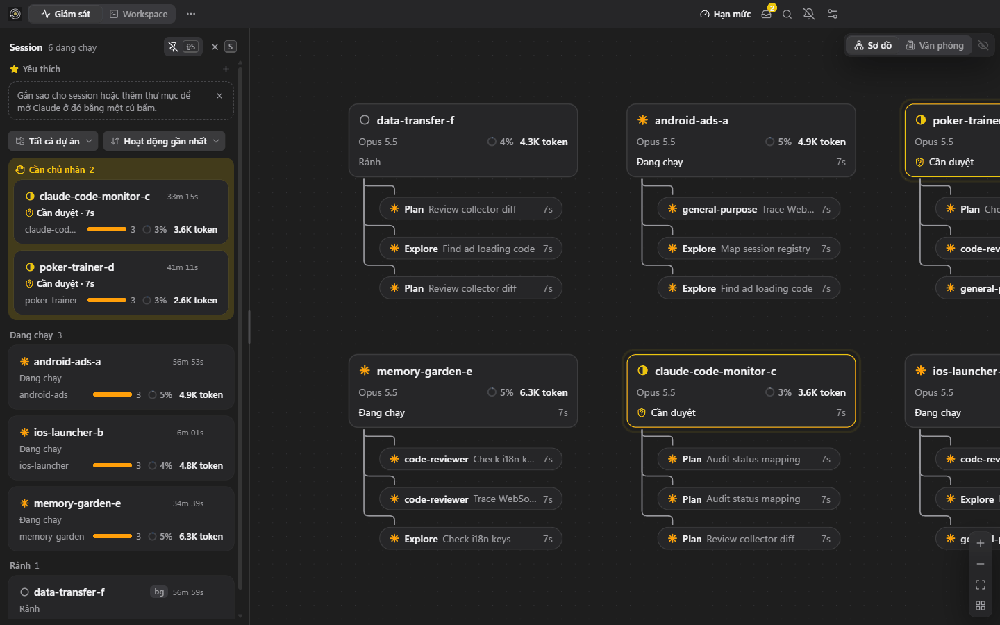
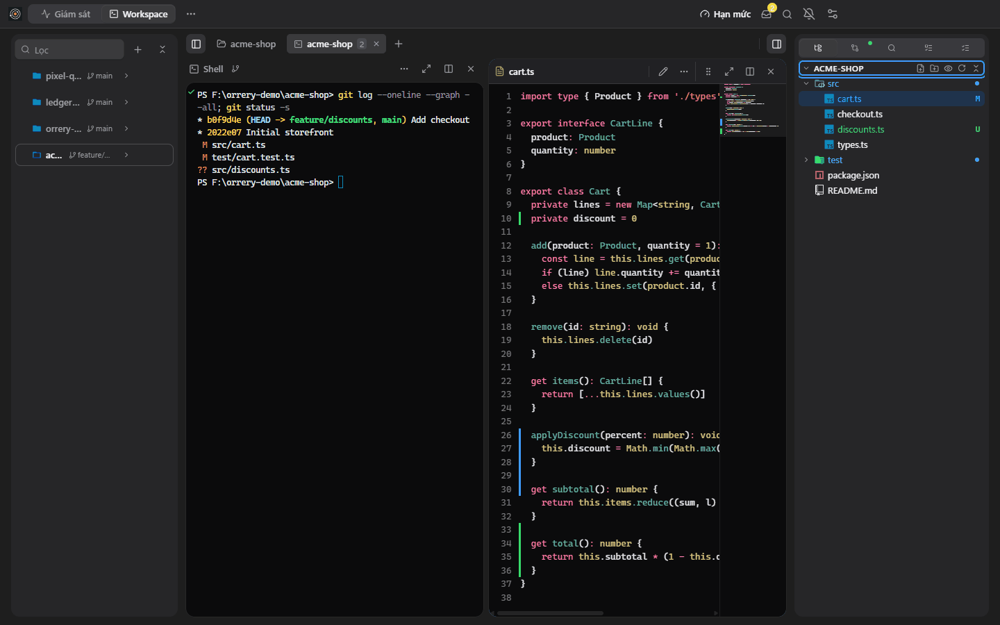
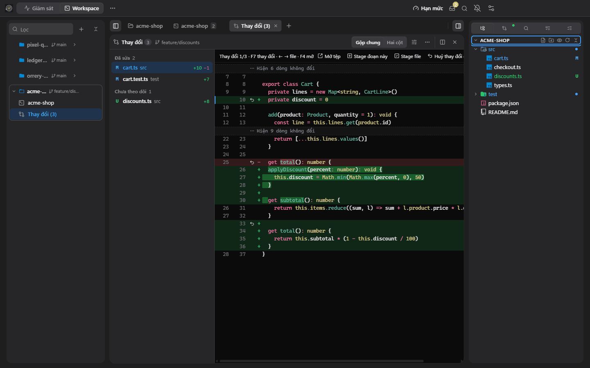
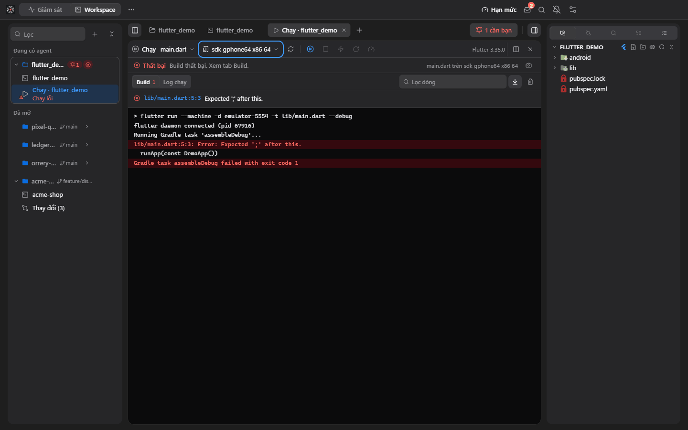
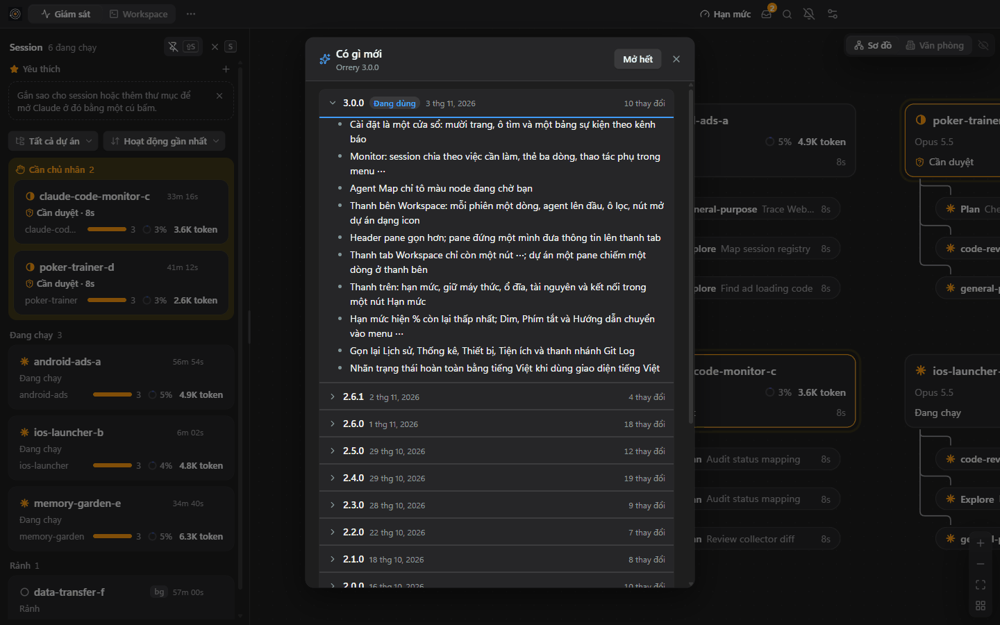

# Orrery

App desktop (Windows, macOS) theo dõi realtime mọi session Claude Code CLI đang chạy, kèm các lần Codex CLI do chúng gọi. Có thêm **Workspace**: terminal, editor, Git và Run ngay trong app.

Tên cũ: Claude Code Monitor, Agent Monitor, GolAIm. Mã nội bộ giữ nguyên (`dev.ccm.monitor`, data `ccm`, biến `CCM_*`) nên bản cũ cập nhật thẳng, không mất cài đặt.



| Workspace: terminal, editor, Explorer | Changes: diff, stage từng đoạn |
|---|---|
|  |  |
| **Run pane: bắt crash, điền vào agent** | **Có gì mới** |
|  |  |

## Nguyên tắc

- **Chỉ quan sát**: đọc file local của Claude Code / Codex (session, transcript, hook).
- Không gọi API, không gửi prompt, không chạy LLM khác: **không tốn thêm token**. Ngoại lệ do bạn bấm: **Compact…**.
- **Chỉ local**: collector bind `127.0.0.1`, từ chối request không mang khoá của app.
- Không đưa nội dung prompt, tham số tool, env hay secret ra giao diện. Token chỉ hiện khi có số liệu thật.
- Không gửi gì ra ngoài, trừ **Báo ra điện thoại** (Cài đặt › Thông báo, mặc định tắt).

## Tính năng

**Giám sát**
- Danh sách session theo nhóm Cần chủ nhân / Đang chạy / Rảnh: nhánh, % context, thay đổi chưa commit, nhảy tới đúng terminal.
- Agent Map main → sub-agent; Codex CLI do Claude gọi hiện thành node con.
- Usage (token, chi phí ước tính, giới hạn gói) và History (heatmap, recap, tìm session cũ rồi Resume).
- Thông báo khi session chờ bạn; báo ra điện thoại qua ntfy / Discord khi bạn rời máy.
- Office pixel-art: mỗi dự án một phòng, mỗi agent một nhân vật.

**Workspace**
- Terminal trong app (Claude Code / Codex / shell): tab, chia ô, nhóm tab, phóng ô, hoàn tác đóng, Mission Control, worktree.
- Khôi phục workspace sau khi khởi động lại hoặc app tắt bất thường (`--resume`).
- Chuyển dự án nhanh `Ctrl+Alt+P` (macOS `⌃⌥P`), `Ctrl K` mở bảng lệnh.
- Editor có tô màu cú pháp, tự lưu (tuỳ chọn), Outline, Local History; Explorer icon Atom Material.
- Tìm / thay trong nhiều file, TODO, pane Trình duyệt, ghi chú dự án, Plan board.

**Git**
- Changes: diff hai cột, stage / commit, blame, bỏ từng đoạn, giải xung đột theo khối.
- Log: đồ thị, nhánh; push / pull bằng nhiều tài khoản GitHub (token cất trong keychain).
- Checkpoint theo lượt agent; so sánh và gộp worktree.

**Run và thiết bị**
- Run pane Android / Flutter: bắt crash, ANR; **Điền vào agent** (đã che bí mật).
- Tab Thiết bị: kết nối Android qua USB / Wi-Fi, chụp / quay màn, emulator, xem SQLite / SharedPreferences.
- Đo hiệu năng app, kiểm trợ năng, duyệt file trên máy.
- Phân tích dung lượng APK / AAB; Kiểm phát hành Android / Flutter.

**Preview**
- XML Layout Preview và Flutter Widget Preview.
- Xem trước Markdown, cây JSON / YAML, xem log, gửi request `.http`.

**Tiện ích**
- **Tài nguyên**: RAM / CPU từng session, server, daemon; báo và tắt thứ bị bỏ quên; bản đồ cổng.
- Dữ liệu agent: đo, dọn cache, chuyển sang ổ khác; Dọn đồ build; cảnh báo ổ sắp đầy.
- Canh nhạy cảm: cảnh báo sửa `.env`, keystore, `git push --force`, xoá đệ quy; Chặn lần sau.
- Thư viện prompt, hàng chờ prompt, hỏi quyền theo dự án, cảnh báo nhiều agent cùng sửa một file.
- Extensions: cài MCP server / plugin, quản lý hook Claude Code.
- Cập nhật trong app từ GitHub Releases (kiểm SHA-256).

**Cài đặt**
- Cửa sổ Cài đặt có ô tìm; giao diện sáng / tối, nhiều theme, đổi font, tiếng Việt / English.
- Giữ máy thức khi agent đang làm; thư mục chụp / quay riêng.
- Sao lưu: xuất / nhập cấu hình sang máy khác (không xuất token).

## Cài đặt

Tải bản mới nhất ở [GitHub Releases](https://github.com/JLSoft-Together/Claude-Code-Monitor/releases).

| Hệ điều hành | File |
|---|---|
| Windows 10 / 11 | `Orrery-Setup-<ver>.exe` hoặc `Orrery-Portable-<ver>.exe` |
| macOS Apple Silicon / Intel | `Orrery-<ver>-arm64.dmg` / `Orrery-<ver>-x64.dmg` |

- **Yêu cầu**: Claude Code CLI `2.1.289` (bản khác vẫn chạy, có cảnh báo). Git, VS Code không bắt buộc.
- Mở app rồi chạy `claude` ở terminal bất kỳ: session hiện lên trong khoảng 1 giây.
- **Windows**: exe chưa ký số. SmartScreen cảnh báo lần đầu → **More info → Run anyway**. Đóng cửa sổ = ẩn xuống tray.
- **macOS**: app ký ad-hoc, chưa notarize. Kéo vào **Applications**, mở → bị chặn → **System Settings → Privacy & Security → Open Anyway** (hoặc `xattr -dr com.apple.quarantine "/Applications/Orrery.app"`).
- Đã cài bản tên cũ: cài đè (Windows) hoặc xoá `GolAIm.app` / `Agent Monitor.app` / `Claude Code Monitor.app` sau khi chép bản mới (macOS).
- **Giới hạn gói**: bật ở Cài đặt → Status line, chép lệnh vào `~/.claude/settings.json`.

## Biến môi trường

| Biến | Mặc định | Ý nghĩa |
|---|---|---|
| `CCM_PORT` | `4317` | Port collector |
| `CLAUDE_CONFIG_DIR` | `~/.claude` | Thư mục data Claude Code |
| `CODEX_HOME` / `CCM_CODEX` | `~/.codex` / `1` | Data Codex; `CCM_CODEX=0` tắt theo dõi Codex |
| `CCM_DATA_DIR` | `%LOCALAPPDATA%/ccm` (macOS `~/Library/Application Support/ccm`) | Cache, tên session, lịch sử |
| `CCM_TOAST` | `1` | `0` = tắt toast / cảnh báo hệ thống |

Gặp lỗi: mở **Cài đặt → Chẩn đoán**, **Lưu file log…** để gửi kèm.

## Build từ source

Cần Node.js `20.19+` hoặc `22.12+`.

```powershell
npm install
npm run desktop       # build web rồi chạy app Electron (dev)
npm test              # Vitest mọi workspace
npm run typecheck     # tsc / vue-tsc
npm run dist          # đóng gói theo OS (không cross build)
```

```
apps/collector      Node.js + TS: đọc session, transcript, hook; WebSocket
apps/web            Vue 3 + Vite + Tailwind + Pinia + vue-i18n + Vue Flow + xterm.js
apps/desktop        Electron: collector + PTY host, tray, Run, thiết bị, Git, đóng gói
packages/shared     Kiểu dữ liệu + protocol dùng chung
```

## Ghi công

- [Habblaud](https://github.com/marmottajr/habblaud) (MIT): Office pixel-art, vendored trong `packages/habblaud`.
- [Atom Material Icons](https://github.com/AtomMaterialUI/iconGenerator) (MIT): icon file / thư mục.
- Font mở kèm app: SIL OFL / Ubuntu Font Licence, xem `apps/web/public/fonts-LICENSES.txt`.
