<p align="center">
  
</p>

<h1 align="center">Habblaud</h1>

<p align="center">
  <b>La oficina virtual de tus agentes de Claude Code (y de Codex).</b><br />
  Cada proyecto se convierte en una sala, y cada agente, en un personaje en pixel art que muestra en tiempo real lo que está haciendo.
</p>

<p align="center"><a href="README.md">English</a> · <a href="README.pt-BR.md">Português</a> · <b>Español</b> · <a href="README.fr.md">Français</a></p>

<p align="center">
  
  
  
  
  
</p>

<p align="center">
  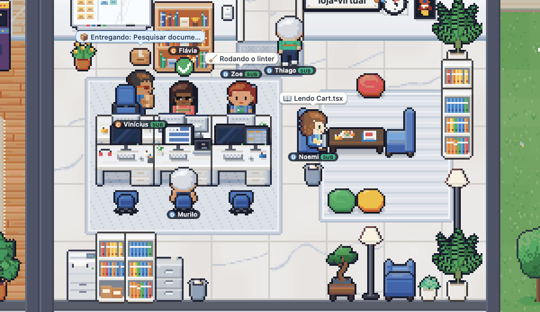
</p>

---

Abres Claude Code en varios proyectos, lanzas subagentes, dejas tareas en marcha… y pierdes la noción de quién está
haciendo qué. **Habblaud** convierte todo eso en una oficina que se entiende de un vistazo: quién está tecleando,
quién levantó la mano porque **te necesita**, quién entregó el trabajo y se fue, quién salió a tomar un café
mientras espera la próxima instrucción, y cuánto llevas gastado de cada cuenta en la sesión de 5 horas y en la semana.

Y cuando dos o más agentes no tienen nada que hacer, la oficina cobra **vida social**: cada uno tiene su propia
personalidad, y ven fútbol juntos en el salón, juegan videojuegos y ping-pong, chismean en la cocina, se arreglan
frente al espejo y se apuestan monedas a piedra, papel o tijera. Míralo en [Vida social](#vida-social).

Todo se ejecuta en tu máquina, leyendo los archivos que el propio Claude Code ya guarda (y solo las líneas `alias` de
tu shell, para asignarle una letra a cada cuenta). Nada sale de tu computadora: Habblaud no lee credenciales ni hace
llamadas externas.

## Índice

- [Cómo se ve](#cómo-se-ve)
- [Instalación](#instalación)
- [Cómo usar](#cómo-usar)
- [Cuentas y uso (5 horas y semanal)](#cuentas-y-uso-5-horas-y-semanal)
- [Configuración](#configuración)
- [Habblaud World](#habblaud-world)
- [Cómo funciona](#cómo-funciona)
- [Privacidad y seguridad](#privacidad-y-seguridad)
- [Desarrollo](#desarrollo)
- [Solución de problemas](#solución-de-problemas)
- [Aviso](#aviso)
- [Licencia](#licencia)
- [Vida social](#vida-social)

## Cómo se ve

**Vista general.** El edificio tiene recepción con ascensores, cocina, baños y salón; cada proyecto con una sesión
abierta tiene su propia sala a lo largo del pasillo. Arriba, los contadores y el uso de cada cuenta; a la izquierda,
las salas y los agentes; abajo, el feed de actividad.

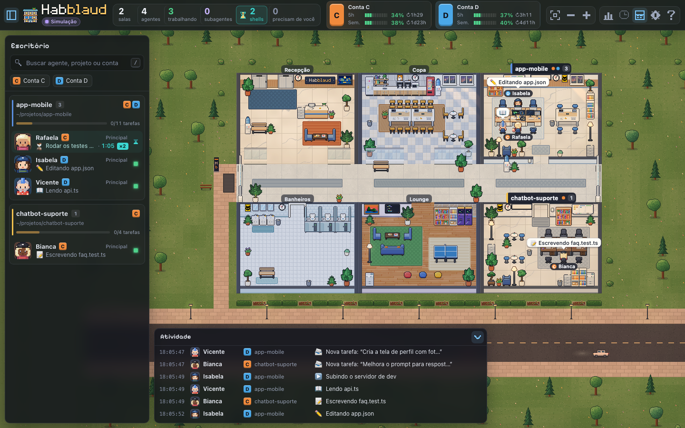

<table>
  <tr>
    <td width="50%">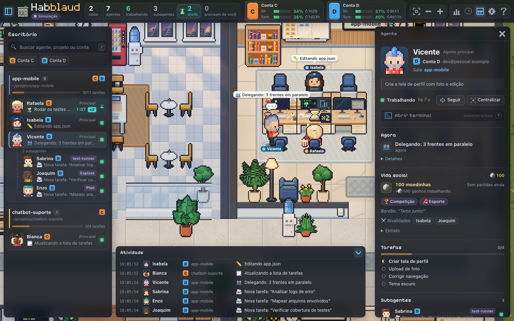</td>
    <td width="50%">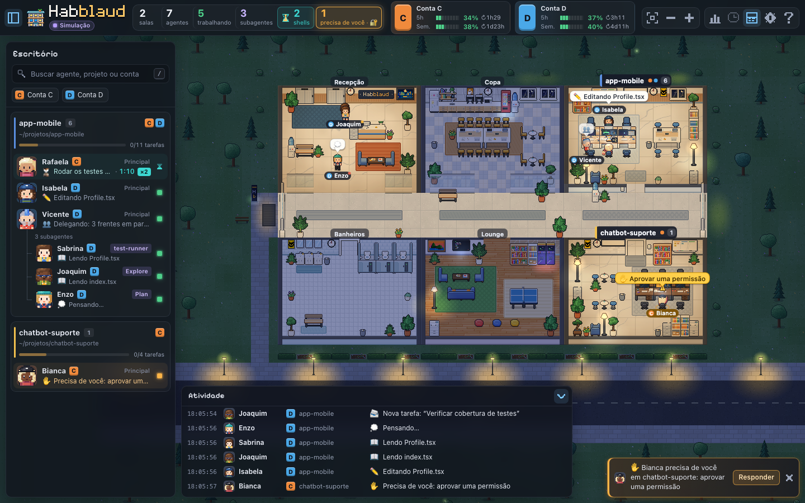</td>
  </tr>
  <tr>
    <td><b>Detalles del agente:</b> actividad actual, tareas con su progreso, subagentes, línea de tiempo y estadísticas.</td>
    <td><b>Día y noche:</b> el cielo en las ventanas y la iluminación siguen la hora local.</td>
  </tr>
</table>

<table>
  <tr>
    <td width="42%">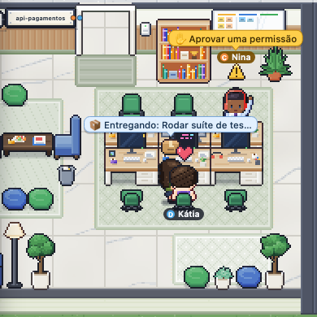</td>
    <td width="58%">
      <b>Colaboración a la vista.</b> Los subagentes son compañeros con nombre propio y gafete: llegan por el ascensor,
      trabajan en la sala del proyecto y, al terminar, van hasta el agente que los llamó a entregarle el resultado (📦)
      antes de irse.<br /><br />
      <b>Te necesita.</b> Cuando un agente espera un permiso o una respuesta en la terminal, corre a su escritorio y
      levanta la mano, con una alerta parpadeando, y aparece un aviso en pantalla (opcionalmente con sonido y notificación
      del navegador). Desde ahí mismo puedes aprobar, responder la pregunta o enviarle la siguiente instrucción.
    </td>
  </tr>
</table>

<table>
  <tr>
    <td width="58%">
      <b>Esperando el shell.</b> Cuando el agente termina su turno pero deja un comando en ejecución (pruebas, build,
      deploy…), no sale a pasear: se queda en su escritorio con un reloj de arena girando sobre la cabeza, la terminal
      mostrando el progreso y un globo con el comando y el tiempo. Y la espera se vuelve comedia: primero come palomitas
      mirando la terminal; a los 3 min se cruza de brazos y da vueltas en la silla; a los 10 min junta telarañas; a los
      25 min se queda dormido. Cuando el comando termina, se levanta y lo celebra con confeti, o le cae una nube de
      lluvia si falló. En la lista lateral y en los detalles, un cronómetro muestra cuánto tiempo lleva cada comando en
      ejecución.
    </td>
    <td width="42%"></td>
  </tr>
</table>

**La luz se apaga.** Cuando cierras la última sesión de un proyecto, el último personaje va hasta el interruptor,
apaga la luz y sale por el ascensor; luego la sala se desmonta y se convierte en jardín hasta que llegue un proyecto
nuevo. Si el jardín quedó entre dos salas, la sala más lejana se muda ahí: se monta en el lugar libre, el equipo
camina hasta ella y la dirección antigua se apaga y se desmonta. Así el edificio no se queda con huecos y se encoge
solo.

| 1. La sala se monta, todavía a oscuras | 2. Alguien enciende la luz y todos trabajan | 3. El último sale y apaga la luz | 4. La sala se convierte en jardín |
| --- | --- | --- | --- |
| 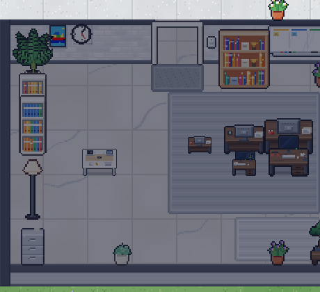 | 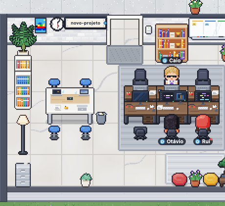 | 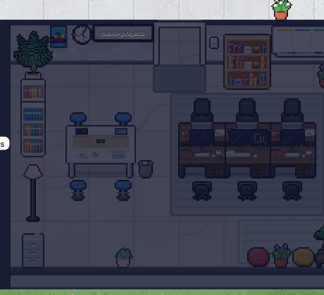 | 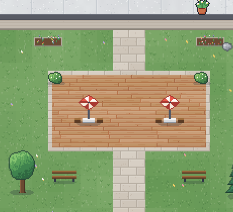 |

<table>
  <tr>
    <td width="34%">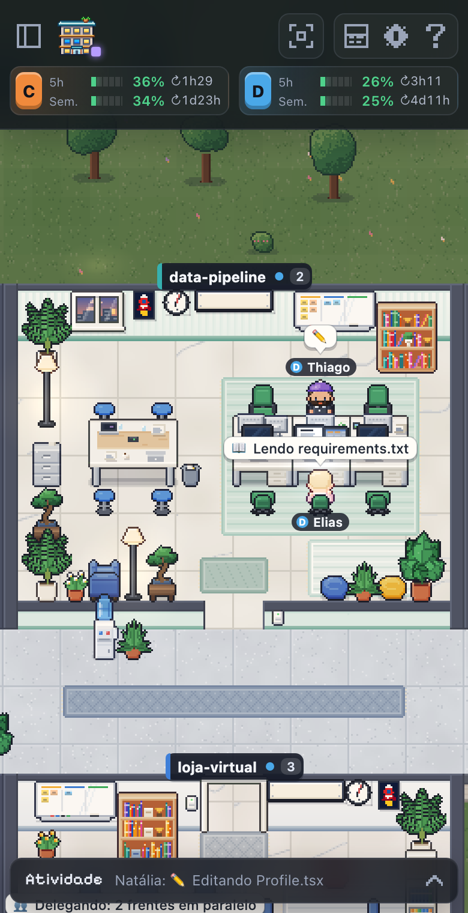</td>
    <td>
      <b>También en el celular.</b> La interfaz se adapta a pantallas pequeñas: el uso de las cuentas queda arriba, la
      lista de salas se convierte en un panel deslizable y los detalles se abren de abajo hacia arriba. Mira cómo
      habilitar el acceso desde la red local en <a href="#abrir-en-el-celular-opcional">Abrir en el celular</a>.
    </td>
  </tr>
</table>

> Las imágenes de arriba usan el **modo demostración** (proyectos, personas y cuentas ficticios).

## Instalación

### Requisitos

- **macOS** (probado) o Linux.
- **[Claude Code](https://code.claude.com)** instalado, con una o más cuentas (2.1.287 o más reciente para el mod).
- **Node.js 22.12+** y **npm** (desarrollado con Node 24; Docker ya usa Node 24).
- **Docker Desktop** (o Docker Engine con Compose v2), si lo vas a ejecutar en un contenedor.

### 1. Descarga el proyecto

```bash
git clone https://github.com/marmottajr/habblaud.git
cd habblaud
npm install
```

> `npm install` solo descarga herramientas de compilación (Vite, TypeScript, tsx…). El servidor de Habblaud no tiene
> dependencias de runtime: usa solo módulos nativos de Node.

### 2. Inicia Habblaud

**Opción A: Docker (recomendado para dejarlo siempre encendido)**

```bash
npm run docker:up
```

El script detecta tus cuentas de Claude Code, monta solo las carpetas necesarias (en modo de solo lectura), construye
la imagen e inicia el contenedor, que se reinicia solo junto con Docker. Abre **http://localhost:4747**.

**Opción B: Node, sin Docker**

```bash
npm run build
npm start
```

Abre **http://localhost:4747**. Para desarrollar, usa `npm run dev` (servidor + Vite con recarga automática).

Ahora abre Claude Code en cualquier proyecto y mira cómo tu agente llega por el ascensor. 🎉

### 3. Instala el mod de Habblaud en Claude Code (recomendado)

```bash
npm run mod:install                        # o mod e os plugins de permissões e de mensagens, em cada conta
npm run mod:install -- --sem-permissoes    # sem responder permissões e perguntas pelo escritório
npm run mod:install -- --sem-mensagens     # sem mandar mensagens aos agentes pelo escritório
```

Habblaud incluye un [mod](https://code.claude.com/docs/en/plugins/mods/overview) (un plugin que se ejecuta dentro de
Claude Code) y lo instala en cada cuenta, con el propio `claude plugin`, a partir de esta carpeta. Con él:

- el **uso de 5 horas y semanal** de cada cuenta aparece en vivo en Habblaud;
- la terminal muestra una línea cuando **otra sesión te necesita** (permiso o respuesta);
- el comando **`/habblaud`** pasa a existir en Claude Code;
- puedes **aprobar o rechazar desde la oficina** las solicitudes de permiso ("Do you want to…") y **responder las
  preguntas** del agente, con el plugin `habblaud-permissoes` (consulta [Responder desde la oficina](#responder-desde-la-oficina));
- puedes **enviarle mensajes** al agente desde la oficina, como si escribieras en su terminal, con el plugin
  `habblaud-mensagens` (consulta [Enviar mensajes](#enviar-mensajes)).

Requiere **Claude Code 2.1.287 o más reciente** (`claude --version`). El mod se ejecuta dentro de cada sesión, con tus
permisos, y accede solo a lo que está listado en [`mod/README.md`](mod/README.md); para revisarlo sin ejecutar nada,
`claude plugin validate mod/habblaud` muestra los eventos que maneja y las llamadas que hace. Las sesiones ya abiertas
cargan el mod con `/reload-plugins` (o al volver a abrirlas). Si la cuenta tenía el método antiguo (abajo), `mod:install`
quita el tap y el hook del `settings.json` (con copia de seguridad), porque el mod hace lo mismo. Compruébalo con
`npm run mod:status`; para deshacerlo: `npm run mod:uninstall`.

> El mod se lee desde esta carpeta. Si mueves la carpeta, vuelve a ejecutar `npm run mod:install`.

<details>
<summary><b>Claude Code anterior a 2.1.287: el método antiguo</b></summary>

Sin mods, el uso en vivo y responder desde la oficina vienen de dos instaladores que editan el `settings.json` de cada
cuenta (con una copia de seguridad antes):

```bash
npm run usage:install    # põe um "tap" na frente do statusline de cada conta, que captura o uso de 5h/semanal
npm run hooks:install    # acrescenta o hook PermissionRequest, para responder permissões pelo escritório
```

Tu statusline se sigue viendo igual. Para deshacerlo: `npm run usage:uninstall` y `npm run hooks:uninstall`.
Los dos apuntan a esta carpeta: si la mueves, vuelve a ejecutarlos (mientras tanto, el statusline de las cuentas
muestra un error). Cuando actualices Claude Code, cámbialos por el mod: `npm run mod:install` quita el tap y el hook
antiguos (con copia de seguridad) para que no queden dos capturando el uso o respondiendo la misma solicitud.

</details>

### 4. Codex en la oficina (opcional)

Si también usas **Codex** de OpenAI (la CLI `codex` o la app), sus sesiones entran en la misma oficina: cada
proyecto es una sala (la misma sala de Claude Code, cuando los dos están abiertos en el mismo proyecto) y cada sesión,
un personaje con el sello **CODEX**. Habblaud encuentra solo la carpeta de Codex (`~/.codex`, `CODEX_HOME` o
`~/.codex*`) y lee las conversaciones, sin instalar nada. Para ver Codex **en vivo** (qué está haciendo ahora, quién
te necesita) y aprobar comandos desde la oficina, instala los hooks:

```bash
npm run codex:install      # acrescenta os hooks do Habblaud em ~/.codex/hooks.json (backup antes; os outros ficam)
npm run codex:status       # confere
```

Después, **abre Codex y aprueba los hooks de Habblaud en `/hooks`**: Codex solo ejecuta un hook nuevo después de que
lo apruebas (Habblaud nunca guarda esa aprobación). Con Habblaud en Docker, para enviar mensajes a las sesiones de
Codex deja también `npm run codex:bridge` en ejecución en el Mac (consulta [Codex](#codex)).

### Abrir en el celular (opcional)

Por defecto, Habblaud solo acepta conexiones de la propia computadora. Para abrirlo en el celular (en la misma red
Wi-Fi), con Docker:

```bash
printf 'HABBLAUD_BIND=0.0.0.0\n' > .env
npm run docker:up -- --no-build
```

Luego abre `http://<ip-do-computador>:4747` en el celular (en macOS: `ipconfig getifaddr en0`; si sale vacío,
`ipconfig getifaddr en1`). En modo Node, usa `HABBLAUD_HOST=0.0.0.0 npm start`.

> ⚠️ Con esto, cualquier dispositivo de la red ve la actividad de los agentes (comandos, archivos, títulos de las
> sesiones). Úsalo solo en redes de confianza. La [terminal](#terminal) (y con ella responder y enviar mensajes desde
> la oficina) queda desactivada mientras el puerto esté expuesto. Para volver atrás: borra el `.env` y ejecuta
> `npm run docker:up -- --no-build`.

#### Celular con inicio de sesión y HTTPS (aprobar solicitudes)

En lugar de exponer el puerto principal, abre un **segundo puerto con usuario, contraseña y HTTPS**. El 4747 queda solo
en la computadora (los hooks, los plugins y tu navegador siguen funcionando sin iniciar sesión); el puerto remoto va a
la red y toda solicitud en él exige iniciar sesión. Lo que separa a los dos es el puerto por el que llegó la conexión,
nunca el encabezado Host. Nada de esto existe antes del setup: sin él, no se publica ningún puerto extra.

```bash
npm run remote:setup   # usuário, senha, nome do endereço e (opcional) um endereço próprio
npm run docker:up
```

`remote:setup` guarda en el `.env` solo el **hash** de la contraseña (scrypt), crea una CA local y el certificado del
servidor en `~/.habblaud/remote-tls` y deja un servicio que anuncia `<nome>.local` en la red (mDNS; LaunchAgent en
macOS, systemd en Linux). Abre `https://<nome>.local` en el celular (con `:4748` si el puerto 443 estaba ocupado). La
primera vez, acepta el aviso, toca **Instala el certificado de Habblaud** y confía en él (iPhone: Configuración ›
Perfil descargado › Instalar y luego Configuración › General › Información › Configuración de confianza de
certificados; Android: Seguridad › Encriptación y credenciales › Instalar un certificado › Certificado de CA),
comprobando la huella digital que mostró el setup.

- **CA restringida:** solo firma `localhost`, nombres `.local`, tu dirección propia e IP de red privada. Aunque su
  clave se filtrara, el celular que confía en ella rechazaría un certificado para cualquier otro sitio. Cambiar la
  dirección propia crea una CA nueva (vuelve a instalar el certificado en el celular). La clave de la CA nunca entra en
  el contenedor.
- **Dirección propia** (p. ej., `meuclaude.home`): entra en el certificado, pero el celular solo la encuentra con una
  entrada en el DNS del router que apunte a la IP de la computadora. `<nome>.local` funciona sin configurar nada.
- **Qué puede hacer el celular:** por defecto, aprobar y rechazar solicitudes de permiso. `HABBLAUD_REMOTE_ALLOW` en
  el `.env` acepta `permissions`, `messages`, `terminal` y `spawn`, separados por comas, o `none` (solo ver). La
  terminal interactiva nunca funciona desde el celular.
- **Entregas** (celular, con `terminal` permitido): el botón de la cajita en la barra superior lista lo que terminó
  cada agente, con un resumen y adjuntos (capturas de pantalla, PDFs, archivos que envió) que se abren con un toque.
- **Nuevo agente** (el botón **+**): inicia una sesión de Claude Code en segundo plano en la computadora (`claude --bg`,
  en la carpeta elegida), que aparece en la oficina y recibe mensajes y solicitudes de permiso a través de Habblaud. En
  una carpeta en la que Claude Code todavía no confía, abre ya completada la pantalla de sesión nueva de la app de
  Claude, y tú presionas Enter allí. **Viene desactivado:** necesita `HABBLAUD_PTY=1` (la misma activación que la
  [terminal interactiva](#terminal-interactiva-tomar-el-control-nueva-sesión-y-cerrar); en Docker, ponla en el `.env` y
  deja `npm run codex:bridge` en ejecución en la computadora) y, desde el celular, también `spawn` en
  `HABBLAUD_REMOTE_ALLOW`.
- **Dictado** (en Nuevo agente y en el cuadro de mensaje): necesita `whisper-cli` y `ffmpeg` (`brew install whisper-cpp
  ffmpeg`) y un modelo multilingüe en `~/.local/share/whisper/` (`ggml-small.bin` acierta más que `ggml-base.bin`; los
  `.en` solo entienden inglés). Sin ellos, el botón Dictar no aparece. La voz nunca sale de la computadora.
  `HABBLAUD_WHISPER_BIN`, `HABBLAUD_FFMPEG_BIN`, `HABBLAUD_WHISPER_MODEL` y `HABBLAUD_DICTATION_LANGS` (por defecto
  `pt,en`) lo ajustan.
- **Fuera de casa (Tailscale):** con Tailscale en la computadora y en el celular, `tailscale serve --bg --https=443
  https+insecure://127.0.0.1:443` publica el puerto remoto (con inicio de sesión) solo para tus dispositivos, con un
  certificado válido en `https://<computador>.<tailnet>.ts.net`; agrega ese nombre a `HABBLAUD_ALLOWED_HOSTS`. Apunta
  siempre al puerto remoto, nunca al 4747 (que no pide iniciar sesión).
- **Sesión:** 30 días; cambiar la contraseña (ejecutar el setup de nuevo) las cierra todas, y **Configuración ›
  Acceso desde el celular › Salir** cierra la de ese dispositivo. Después de 5 contraseñas incorrectas seguidas, cada nuevo intento espera de
  1 s a 5 min.
- **¿Cambió la IP?** `docker:up` vuelve a emitir el certificado del servidor cuando falta la IP nueva o cuando faltan
  30 días para que venza, con la misma CA (el celular sigue confiando en ella); el servidor cambia el certificado sin
  reiniciarse.
- **Desactivar:** `npm run remote:setup -- --off` y `npm run docker:up`.

Sin HTTPS, el puerto remoto no se inicia; `HABBLAUD_REMOTE_INSECURE_HTTP=1` fuerza HTTP plano (contraseña y cookie a
la vista en la red). En modo Node: `HABBLAUD_REMOTE_PORT` y `HABBLAUD_REMOTE_HOST` (por defecto `0.0.0.0:4748`) y
`HABBLAUD_REMOTE_TLS_DIR` (por defecto `~/.habblaud/remote-tls/server`).

### Actualizar

La versión en uso aparece en la barra superior, junto a "Conectado", y en **Configuración › Acerca de**. Cada 6 horas,
Habblaud revisa en GitHub si salió una versión nueva (las [releases](https://github.com/marmottajr/habblaud/releases)
de este repositorio). Cuando sale, aparece el sello verde **Nueva versión** en lugar del número, con un aviso y un
punto en el botón de configuración. En **Acerca de** están el enlace a lo que cambió y el botón **Comprobar ahora**
(las notas de cada versión también están en el [`CHANGELOG.md`](CHANGELOG.md)). Para actualizar:

```bash
git pull
npm install
npm run docker:up        # ou: npm run build && npm start (e depois npm run mod:install)
```

> Si `git pull` se detiene con "Your local changes to the following files would be overwritten by merge:
> package-lock.json", ejecuta `git checkout -- package-lock.json` y repite: hasta la 0.4.0, `npm install` modificaba ese
> archivo.

`docker:up` también actualiza el mod en las cuentas donde ya está instalado (nunca lo instala por su cuenta) y avisa:
"Mod actualizado a 0.3.0 en Cuenta D; sesiones abiertas: /reload-plugins". En modo Node, ejecuta `npm run mod:install`
después de actualizar. Para no consultar GitHub, usa `HABBLAUD_UPDATE_CHECK=0` (en el `.env`, para Docker).

#### Si vienes de CodeTown

Habblaud se llamaba **CodeTown** hasta la 0.3.2. Después del `git pull`, ejecuta una vez:

```bash
npm install
npm run mod:install      # troca o marketplace e os plugins codetown pelos habblaud, em cada conta
npm run docker:up        # tira o container codetown e copia os dados do volume antigo para o novo
```

- **Mod:** hasta que ejecutes `mod:install`, el Claude Code de las cuentas se queja del marketplace `codetown` (las
  carpetas `mod/codetown*` cambiaron de nombre). `docker:up` avisa, pero no hace el cambio por su cuenta.
- **Docker:** el volumen antiguo (`codetown_codetown-data`) queda intacto. Después de comprobar que los nombres de los
  personajes se conservaron, bórralo con `docker volume rm codetown_codetown-data`, y la imagen antigua con
  `docker image rm codetown:local`.
- **Carpeta local:** `~/.codetown` pasa a ser `~/.habblaud` automáticamente (en el servidor, en `docker:up` y en
  `mod:install`).
- **Navegador:** las preferencias y las monedas pasan a las claves nuevas la primera vez que se abre la página.
- **Variables:** las `CODETOWN_*` ya no funcionan; renómbralas a `HABBLAUD_*` en el `.env` (p. ej., `HABBLAUD_BIND`). El
  servidor y `docker:up` avisan cuando encuentran una antigua.
- **Repositorio:** ahora es `github.com/marmottajr/habblaud` (GitHub redirige la dirección antigua). Para ajustar el
  clon: `git remote set-url origin https://github.com/marmottajr/habblaud.git`. La carpeta local puede seguir con el
  nombre antiguo.
- Las copias de seguridad del `settings.json` hechas antes del cambio conservan el nombre
  `settings.json.codetown-backup-<data>`.

### Desinstalar

```bash
npm run mod:uninstall                       # tira o mod, os plugins de permissões e de mensagens e o marketplace
npm run codex:uninstall                     # tira os hooks do Habblaud do Codex (os outros ficam)
npm run docker:down                         # para o container
docker volume rm habblaud_habblaud-data     # apaga os dados do container (nomes, salas, linha do tempo e estatísticas)
docker image rm habblaud:local              # apaga a imagem
rm -rf ~/.habblaud                          # apaga os dados locais (uso capturado, nomes, salas, linha do tempo e estatísticas)
```

Después solo tienes que borrar la carpeta del proyecto; ejecuta `mod:uninstall` **antes**, porque si no, el Claude
Code de las cuentas empieza a quejarse del marketplace que desapareció. Si usaste el método antiguo, ejecuta también
`npm run usage:uninstall` (restaura el statusline original) y `npm run hooks:uninstall` (quita el hook de permisos);
sin ellos, el statusline de las cuentas empieza a dar error (y el hook, a fallar en silencio). `mod:install`, que quita
el tap y el hook antiguos, y los instaladores y desinstaladores antiguos dejan copias
`settings.json.habblaud-backup-<data>` en la carpeta de cada cuenta (p. ej., `~/.claude/`); bórralas si ya no las
necesitas.

## Cómo usar

### Qué está haciendo cada personaje

| Estado | Lo que ves |
| --- | --- |
| **Trabajando** | En su escritorio, tecleando. El monitor y un globo muestran la actividad: 📖 leyendo, ✏️ editando, 💻 terminal, 🧪 pruebas, 🌐 buscando… |
| **Te necesita** | Corre a su escritorio y levanta la mano, con una alerta parpadeando: está esperando un permiso o una respuesta en la terminal. |
| **Esperando el shell** | Terminó su turno pero dejó un comando en ejecución (pruebas, build, deploy…), así que se queda en su escritorio con un reloj de arena girando sobre la cabeza y la terminal mostrando el progreso: come palomitas mirando, a los 3 min se cruza de brazos y da vueltas en la silla, a los 10 min junta telarañas y a los 25 min se queda dormido; cuando el comando termina, se levanta y lo celebra con confeti (o le cae una nube de lluvia, si falló). Pasados 40 s, si hay compañeros sin nada que hacer, puede salir a una ronda, con el reloj de arena en la cabeza. |
| **Ocioso** | Terminó su turno y pasea: café en la cocina, bebedero, baño, sofá del salón, celular en el puf, espejo. Con compañeros sin nada que hacer, se une a una ronda: TV, videojuegos, ping-pong, charla en la cocina, piedra, papel o tijera (consulta [Vida social](#vida-social)). Tras 10 min sin actividad, se queda dormido, pero un compañero puede despertarlo para una ronda. |
| **Subagente completado** | Va hasta el agente que lo llamó, le entrega el resultado y sale por el ascensor. |
| **Sesión cerrada** | Se va; si era el último de la sala, apaga la luz antes de salir. |

Cada personaje tiene un **nombre brasileño único** (Marina, Henrique, Luan…) que se mantiene mientras exista la
sesión, y un **chip de color con la letra de la cuenta** (C, D…).

### Interfaz

- **Arriba:** contadores (salas, agentes, trabajando, subagentes, shells en ejecución, te necesitan) y una tarjeta de
  **uso por cuenta**. El de shells solo aparece mientras algún comando está en ejecución; haz clic en él para ir hasta
  quien espera. Debajo del logo están la conexión y la versión en uso, que se convierte en el sello **Nueva versión**
  cuando sale una versión nueva (consulta [Actualizar](#actualizar)).
- **Barra lateral:** búsqueda, filtro por cuenta y la lista de salas con sus agentes y subagentes.
- **Panel de detalles:** haz clic en un personaje (en el edificio o en la lista) para ver actividad, tareas,
  subagentes, línea de tiempo y estadísticas (herramientas, tokens, costo, líneas modificadas, modelo, branch).
- **Feed:** las últimas actividades de toda la oficina.
- **Configuración (⚙):** nombres, globos, cuánto pasean los ociosos, ciclo día/noche, sonidos, notificaciones del
  navegador, modo demostración y **Acerca de** (versión en uso y versión nueva). **Ayuda (?):** leyenda completa y
  atajos.
- **Mi día (📊):** adónde se fue el tiempo del día (consulta [Mi día](#mi-día)). **Timelapse** e **Historial** (los
  relojes de la barra superior): consulta [Timelapse del día](#timelapse-del-día) y [Terminal](#terminal).

**Cámara:** arrastra para moverte, usa la rueda para hacer zoom y haz doble clic en un personaje para seguirlo.

**Atajos:** `/` buscar · `F` seguir al seleccionado · `T` terminal · `L` timelapse · `M` mi día · `P` próxima solicitud
(permiso o pregunta) · `O` o `0` vista general · `Esc` limpiar selección · `[` barra lateral · `]` feed · flechas/`WASD`
mover · `+` `-` zoom · `?` ayuda.

### Temas de la oficina

En **Configuración → Apariencia → Tema de la oficina**, elige:

- **Automático** (por defecto): sigue el calendario, en la hora local. Halloween del 1 al 31 de octubre, Navidad del 1
  de noviembre al 26 de diciembre y, el resto del año, el aspecto original.
- **Ninguno**: siempre el aspecto original.
- **Navidad**: guirnaldas, luces cálidas, árboles con regalos, alfombras navideñas, nieve en las ventanas y gorros en
  los personajes.
- **Halloween**: calabazas, fantasmas decorativos, telarañas, murciélagos, luces moradas, alfombras temáticas y
  accesorios de disfraz.

El cambio es inmediato y la elección queda guardada en este navegador. Los temas conservan los caminos,
las actividades y las animaciones de los agentes. El ciclo día/noche sigue siendo una opción independiente.

<table>
  <tr>
    <td width="50%">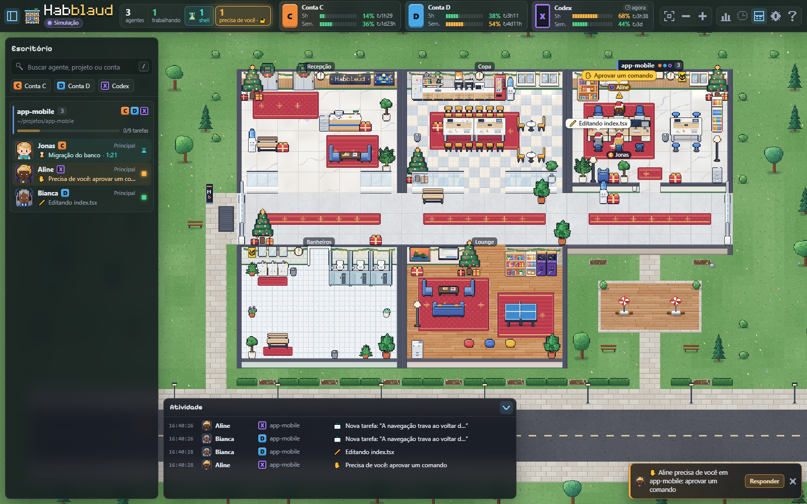</td>
    <td width="50%">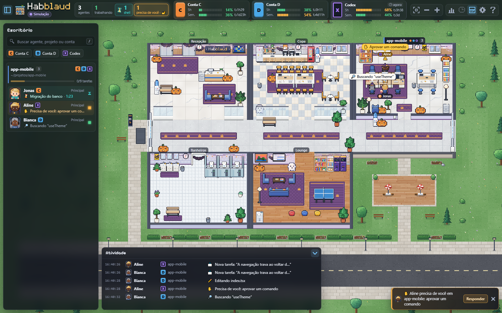</td>
  </tr>
</table>

### Idiomas

La interfaz está en **portugués, inglés, español y francés**. Sigue el idioma del navegador; en
**Configuración › Idioma** puedes fijar uno (la elección queda guardada en este navegador). Los textos que arma el
servidor (actividades, avisos, terminal, logs y los scripts de instalación) siguen `HABBLAUD_LANG` y, si no está
definida, el idioma del sistema, salvo el inglés: muchas máquinas y todos los contenedores vienen en inglés por
defecto, incluso para quien usa otro idioma. Para tener el servidor en inglés, define `HABBLAUD_LANG=en` (en Docker,
en el `.env`). Un texto sin traducción aparece en portugués.

### Día, noche y sonidos

La oficina sigue la **hora local**: de madrugada y de noche el césped y la calle se ponen azulados y oscuros, los
faroles, las lámparas, las máquinas y los monitores encendidos proyectan halos de luz, las salas con gente quedan
iluminadas (la luz que se apaga cuando la sala se vacía sigue funcionando), los autos pasan con los faros encendidos y
aparecen luciérnagas en el jardín. Al amanecer (~5–7 h) y al atardecer (~17–19 h) todo toma un tono cálido, y durante
el día el sol entra por las ventanas y dibuja franjas de luz en el piso: cortas al mediodía, largas y anaranjadas al
final de la tarde. En **Configuración › Ciclo día/noche** puedes elegir automático, siempre de día o siempre de noche;
para probar un horario, usa `?hora=21:30` en la URL.

Los **sonidos** vienen desactivados. Al activarlos en **Configuración › Sonidos**, se sintetizan en el propio
navegador (sin archivos de audio) y suenan bajito: el teclado de quien trabaja en las salas a la vista, el "ding" del
ascensor cuando alguien llega o se va, la campana cuando alguien te necesita, el chasquido de tarea completada y el
ping-pong y el arcade de las rondas. Hay un volumen general y cada categoría se activa y desactiva por separado. Con la
pestaña oculta, solo suena la campana.

### Terminal

Haz clic en un agente y usa **Abrir terminal** para ver la conversación de la sesión tal como la muestra Claude Code:
los prompts, las respuestas, cada herramienta llamada (con el comando o el diff) y el resultado, actualizados en vivo.
Funciona para agentes principales y subagentes; en el modo demostración, la conversación es ficticia.

En el pie, para agentes principales, puedes **escribir**: `Enter` envía y `Shift+Enter` hace un salto de línea. El
texto entra en la sesión como si lo hubieras escrito en su terminal (consulta [Enviar mensajes](#enviar-mensajes)); si
el agente está ocupado, entra cuando termine lo que está haciendo. Los subagentes y las sesiones del historial siguen
siendo de solo lectura.

- **Búsqueda:** con la terminal enfocada, `Ctrl+F` (`⌘F` en Mac) o la lupa del encabezado abre la búsqueda en la
  conversación, sin distinguir mayúsculas ni acentos. El contador muestra la posición ("3/17"); `Enter` y `Shift+Enter`
  van al siguiente y al anterior, y abren los bloques contraídos ("… +N líneas") donde esté el término. La búsqueda
  sigue activa mientras llegan mensajes nuevos. `Esc` cierra la búsqueda; el siguiente cierra la terminal.
- **Filtro:** **Todo**, **Solo prompts** (tus prompts y las respuestas finales del agente, sin los pasos intermedios)
  o **Sin herramientas**.
- **Copiar:** pasa el cursor (o el foco) sobre un prompt, una respuesta, un comando o un resultado para copiarlo.
- **Historial:** el reloj de la barra superior lista las sesiones de los últimos 7 días de todas las cuentas (hasta
  150), agrupadas por día, con búsqueda por título, proyecto o cuenta. Una sesión cerrada se abre en la terminal con el
  proyecto, el título y la fecha en el encabezado y "Sesión cerrada a las …" en el pie; una sesión todavía abierta abre
  la terminal en vivo del agente.

Como la terminal (y el historial) muestra la conversación completa, solo existe cuando Habblaud es accesible
**únicamente desde la propia computadora** (lo predeterminado) y solo se abre por `http://localhost` o
`http://127.0.0.1`. Con el puerto abierto a la red (`HABBLAUD_BIND=0.0.0.0` o `HABBLAUD_HOST=0.0.0.0`), queda
desactivada. Detalles en [Privacidad y seguridad](#privacidad-y-seguridad).

### Terminal interactiva (tomar el control, nueva sesión y cerrar)

Con `HABBLAUD_PTY=1` y ejecutando con `npm start` (fuera de Docker), la ventana de terminal de cada agente principal es
interactiva: el botón **Abrir terminal** del panel, el atajo junto a cada agente en la barra lateral o la tecla `T`
abren la misma ventana, con pestañas para los demás agentes del mismo proyecto.

- Sesión abierta aquí: es el Claude Code de verdad (escribir, responder; Esc interrumpe al agente, como en la
  terminal).
- Sesión abierta en otra terminal: **Tomar el control aquí** (en la parte superior de la ventana) cierra la sesión allá
  y continúa la **misma conversación** aquí (`claude --resume <sessão>`, en la misma carpeta y cuenta). El personaje
  conserva su nombre. En Windows, la terminal de donde salió la sesión vuelve a la normalidad (Habblaud desactiva los
  modos de mouse/teclado que Claude había activado).
- **Cerrar** termina la sesión, esté aquí o en otra terminal (la conversación queda guardada).
- **Nueva sesión** (en el panel de la sala) abre un Claude Code nuevo en la carpeta del proyecto.

Tomar el control y cerrar piden un segundo clic; cerrar la ventana no termina la sesión. La ventana (y el panel del
agente) se puede arrastrar por la barra y redimensionar por la esquina; doble clic en la barra la devuelve a su lugar.
**Viene desactivada:** actívala con `HABBLAUD_PTY=1` (lee antes el aviso en [Privacidad y seguridad](#privacidad-y-seguridad)).
Usa `node-pty`, `@xterm/headless` (dependencias opcionales) y el `claude` del PATH (`HABBLAUD_CLAUDE_BIN` para
otro); solo acepta solicitudes de la propia computadora. Al iniciar, Habblaud abre una terminal de prueba: si `node-pty`
o `claude` no funcionan, la función queda desactivada y el log dice el motivo. **Reiniciar Habblaud cierra las sesiones
que abrió.**
La terminal en vivo sigue disponible en el historial de sesiones, para los subagentes y cuando la interactiva está
desactivada.

### Timelapse del día

El botón **Timelapse** (reloj con la flecha hacia atrás, o la tecla `L`) reproduce el día a alta velocidad: salas que
se encienden y se apagan, agentes que llegan, trabajan, te esperan, van a las rondas, subagentes que entran y salen.
La barra de reproducción tiene el día, play/pausa, la velocidad (60×, 180× o 600×: un día de 10 h en 10, 3⅓ o 1 min),
la línea de tiempo arrastrable con el gráfico de quién estaba presente y trabajando, las marcas de los picos (haz clic
para saltar ahí) y **Ver en vivo**. Mientras tanto, la oficina toma un ligero tono sepia, con el sello **REPLAY 14:32**,
y el feed sigue mostrando lo que pasa ahora.

El servidor graba la línea de tiempo **a partir del momento en que está encendido** (no se puede reconstruir el
pasado): resúmenes de lo que muestra la oficina, sin conversaciones, en `~/.habblaud/timeline/` (en Docker, en el
volumen de datos), con un límite de tamaño por día y los últimos **7 días** guardados. Para no grabar:
`HABBLAUD_TIMELINE=0`. Detalles en [`server/README.md`](server/README.md#linha-do-tempo-timelapse).

Los personajes caminan más rápido en el replay, pero a velocidades altas quien pasa poco tiempo en la oficina casi no
llega a su escritorio; saltar a otro punto los muestra a todos ya en su lugar.
### Responder desde la oficina

Con el plugin de permisos instalado (`npm run mod:install`, que lo instala junto con el mod; en Claude Code anterior
a 2.1.287, `npm run hooks:install`), cuando un agente pide permiso (ejecutar un comando, editar un archivo, abrir una
página), la solicitud aparece en la oficina: el personaje levanta la mano, aparece en pantalla un aviso con
**Responder** y, en los detalles del agente, la tarjeta **Pide permiso** muestra el comando (o el diff de la edición)
con los botones:

- **Aprobar** y, cuando Claude Code lo sugiere, **Aprobar y no volver a preguntar** (la misma regla que ofrecería la
  terminal, por ejemplo `Bash(npm test:*)` en este proyecto);
- **Rechazar**, con un motivo opcional, que le llega al agente, y la opción de interrumpirlo;
- **Responder en la terminal**: Habblaud deja la solicitud de lado.

El diálogo sigue apareciendo en la terminal al mismo tiempo, y vale lo que respondas primero: si respondes en la
terminal, la solicitud desaparece de la oficina sola. El contador **te necesitan** (y la tecla `P`) lleva a cada
solicitud.

**Las preguntas del agente** (`AskUserQuestion`) también: la tarjeta de preguntas muestra cada pregunta con las
opciones y sus descripciones, como las mostraría la terminal. Elige una opción (o varias, cuando la pregunta lo
permite) o escribe la tuya en **Otro**, y usa **Responder**; **Rechazar…** le dice al agente que no quieres responder,
y **Responder en la terminal** deja la pregunta allá. La respuesta le llega al agente como si la hubieras elegido en la
terminal.

- La solicitud pasa por un hook `PermissionRequest` de Claude Code (el del plugin o el del método antiguo), que solo
  la desvía cuando hay **alguna página de Habblaud abierta** en esta computadora; con Habblaud detenido o sin ninguna
  página abierta, sale de inmediato y la terminal sigue como siempre.
- Sin respuesta desde la oficina en 5 minutos (hasta 24 h con `HABBLAUD_PERMISSION_TIMEOUT=86400` en el `env` del
  `settings.json`), la solicitud vuelve a valer solo en la terminal (las opciones del plugin están en
  [`mod/README.md`](mod/README.md); en el método antiguo, `npm run hooks:install -- --timeout 120` cambia el tiempo y
  `--port`, el puerto). En los **subagentes en segundo plano**, Claude Code solo muestra el diálogo en la terminal
  después de que el hook termina: responde desde la oficina o usa **Responder en la terminal**. Con una espera de más
  de 5 minutos, si pasan 5 minutos sin ninguna página abierta que pueda responder (y no hay ningún
  [celular con inicio de sesión](#celular-con-inicio-de-sesión-y-https-aprobar-solicitudes) configurado para
  responder), la solicitud vuelve a la terminal.
- Funciona con el mismo bloqueo que la terminal: solo con Habblaud accesible únicamente desde la propia
  computadora y abierto por `http://localhost`. Compruébalo con `npm run mod:status` (o `npm run hooks:status`, en el
  método antiguo).
  También funciona desde el [celular con inicio de sesión](#celular-con-inicio-de-sesión-y-https-aprobar-solicitudes) (allí, es lo predeterminado).
- En el modo demostración, los agentes ficticios también piden permiso y hacen preguntas (de mentira), para que lo
  pruebes.

### Enviar mensajes

Con el plugin de mensajes instalado (`npm run mod:install`, que lo instala junto con el mod; requiere Claude Code
2.1.287 o más reciente), los detalles de cada agente principal incluyen la sección **Enviar mensaje**, y el pie de la
[terminal](#terminal) se convierte en un cuadro de texto. Escribe y presiona `Enter` (`Shift+Enter` hace un salto de
línea): el texto entra en la sesión **como si lo hubieras escrito en su terminal**. Puedes responder cuando el agente
termina su turno y espera la siguiente solicitud, darle una instrucción nueva o corregir el rumbo, sin buscar la
ventana correcta.

- El cuadro muestra el estado: **en cola** (la sesión busca los mensajes cada 2 segundos), **entregado** o **no se
  entregó**, con el motivo. Con el agente ocupado, el mensaje espera y entra cuando termine su turno, como un prompt
  escrito con el agente trabajando.
- El plugin se ejecuta dentro de cada sesión y solo habla con Habblaud en `127.0.0.1`. Sin él (o en una sesión abierta
  antes de la instalación: usa `/reload-plugins`), aparece la sugerencia de instalación en lugar del cuadro. Los
  subagentes no reciben mensajes.
- Funciona con el mismo bloqueo que la terminal (solo con acceso local) y se puede desactivar con
  `HABBLAUD_MENSAGENS=0`. Lee el aviso en [Privacidad y seguridad](#privacidad-y-seguridad).
  Desde el [celular con inicio de sesión](#celular-con-inicio-de-sesión-y-https-aprobar-solicitudes), solo con `messages` en `HABBLAUD_REMOTE_ALLOW`.
- En el modo demostración, los agentes ficticios también reciben mensajes (de mentira).

### Editar el personaje

Cada sesión llega con un nombre y una apariencia sorteados. Para fijar el personaje de un proyecto, abre los detalles
del agente principal y haz clic en el lápiz junto al nombre (**Editar personaje**). En el editor:

- **Nombre:** hasta 24 caracteres. No puede repetir el de alguien que está en la oficina ni el elegido para otro
  proyecto.
- **Sortear:** trae otra apariencia.
- **Piezas:** piel, cabello, barba, ojos, parte de arriba, parte de abajo, zapatos y accesorio, con la vista previa al
  lado.
- **Guardar:** vale para el proyecto (la sala). La próxima sesión que se abra en él llega con ese personaje. Con dos
  sesiones al mismo tiempo en la misma sala, la segunda recibe un personaje sorteado.
- **Volver al sorteo:** deshace la elección.

La elección queda en `~/.habblaud/names.json` y se borra después de 60 días sin uso del proyecto. El editor tiene el
mismo bloqueo que la terminal: el lápiz solo aparece con la terminal activada (sin `HABBLAUD_TERMINAL=0`) y el acceso
local, es decir, con Habblaud accesible únicamente desde la propia computadora y abierto por `http://localhost`.

### Codex

Las sesiones de Codex (CLI o app) aparecen como las de Claude Code: personaje, sala del proyecto, actividad, tareas,
subagentes, terminal e historial, uso de 5 horas y semanal y **Mi día** (solo tokens: Codex no informa el costo). El
chip de la cuenta de Codex es hueco y lleva el sello **CODEX**.

- **Sin instalar nada**, Habblaud lee los archivos que el propio Codex guarda (las conversaciones en
  `~/.codex/sessions` y los bloqueos de las sesiones abiertas en `~/.codex/thread-writer-locks`). Pero Codex guarda cada
  paso **después** de que termina y nunca guarda "esperándote": sin los hooks, la oficina muestra Codex con retraso y no
  avisa cuando te necesita.
- **Con los hooks** (`npm run codex:install` y aprobarlos en `/hooks`), Codex le avisa a Habblaud en cada paso: la
  sesión aparece al instante, la actividad es la actual y una solicitud de aprobación hace que el personaje levante la
  mano.
- **Aprobar desde la oficina:** con alguna página de Habblaud abierta, la solicitud de aprobación de Codex espera tu
  respuesta en la tarjeta **Pide permiso** hasta **25 segundos** (`npm run codex:install -- --espera <s>`, de 5 a 120):
  **Aprobar** o **Rechazar** (con el motivo). A diferencia de Claude Code, Codex solo muestra la aprobación en la
  terminal **después** de que la oficina responde o se acaba el plazo; mientras tanto, la terminal muestra "Esperando
  respuesta en Habblaud…". No hay "permitir siempre" ni "interrumpir", y Codex no deja responder sus preguntas desde
  fuera.
- **Enviar mensajes:** el cuadro **Enviar mensaje** también funciona con Codex, a través de `codex queue`: el mensaje
  entra en la cola de la sesión y Codex lo toma cuando termina lo que está haciendo (hasta unos 10 segundos después). En
  modo Node, el propio Habblaud ejecuta el comando; **en Docker**, deja `npm run codex:bridge` en ejecución en el Mac
  (el contenedor no ve tu Codex).
- **Uso de 5 horas y semanal:** viene de los propios archivos de Codex y solo se renueva mientras alguna sesión está en
  ejecución; la tarjeta muestra la antigüedad de los números y "sin cuota" cuando el workspace se quedó sin créditos.
- **Cuándo entra la sesión:** con el primer mensaje (que es cuando Codex guarda la carpeta del proyecto); una CLI
  abierta y todavía sin conversación no aparece.
- **Cuándo sale la sesión de la oficina:** la CLI de Codex ejecuta las sesiones en un servidor en segundo plano, que
  las mantiene cargadas hasta un minuto después de quedar inactivas y sin que nadie las mire; por eso el personaje
  puede tardar un poco en irse después de que cierras la terminal.
- Las conversaciones en la nube de ChatGPT (sin archivo en la computadora) no aparecen. `HABBLAUD_CODEX=0` desactiva
  Codex.

### GitHub en la oficina

Lo que los agentes hacen en GitHub anima la sala del proyecto, sin token y sin acceder a internet: Habblaud lee en
los transcripts las llamadas (`gh pr create`, `gh pr merge`, `git push`, `gh run watch`, `gh pr checks`, `gh run view`,
`gh release create` y las herramientas del MCP de GitHub) y sus resultados.

| Evento | Qué pasa |
| --- | --- |
| 🎉 **PR abierto o fusionado, release publicada** | Cae confeti en la sala, todos celebran dando saltitos y una pancarta dice el motivo ("¡PR #12 fusionado!") durante ~12 s. |
| 🚨 **CI en rojo** | Luces giratorias parpadeando en las esquinas de la sala, suelo rojizo y un globo "!" sobre quien vio el fallo, hasta que haya un CI en verde en la sala (que se vuelve fiesta) o durante 10 min. |
| 🚀 **Push** | Solo el aviso y el feed. |

<table>
  <tr>
    <td width="50%">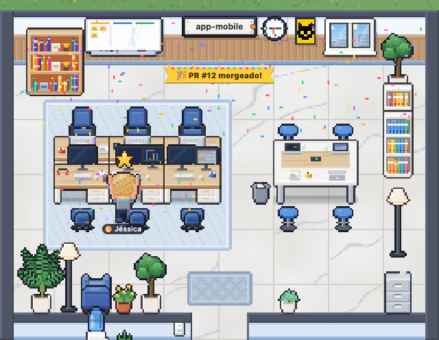</td>
    <td width="50%">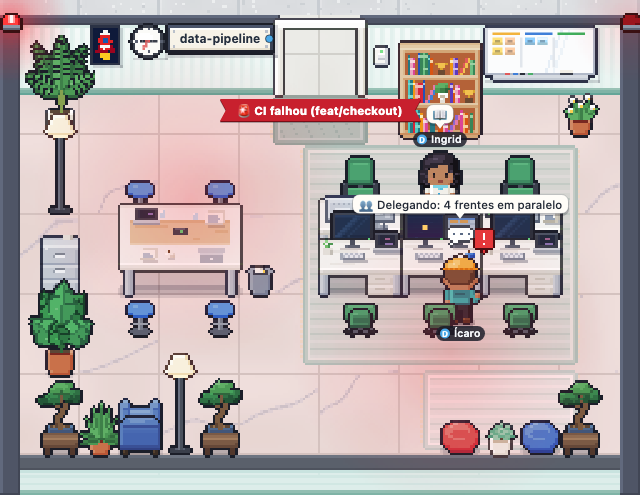</td>
  </tr>
</table>

Cada evento también genera un aviso ("🎉 Danilo abrió el PR #12 en habblaud", "🚨 CI falló en habblaud (feat/x)") y
entra en el feed. Solo lo que pasa en vivo anima la sala: lo que ya estaba en los transcripts cuando se abrió Habblaud
va solo al historial. Con "reducir movimiento" activado en el sistema, nada parpadea ni gira. En el modo demostración,
aparecen de vez en cuando PRs, merges y CIs ficticios.
### Mi día

El botón **Mi día** (o la tecla `M`) muestra adónde se fue el día: cuánto tiempo pasaron los agentes trabajando y,
destacado, cuánto tiempo pasaron **esperándote** (permiso, pregunta o elección), con la espera más larga, quién
esperó, dónde y cuándo. Al lado, sesiones, subagentes, solicitudes, tokens y costo (cuando Claude Code registra el
costo en el transcript), y gráficos por hora, por proyecto (del que más te esperó al que menos) y por cuenta, además
del ranking de las esperas más largas. Elige el día en el selector (Habblaud guarda los últimos 30); abierto en el día
de hoy, el panel se actualiza cada 30 s. Cada gráfico tiene una versión en tabla, y la leyenda activa y desactiva cada
estado.

El tiempo es **tiempo de agente**: dos agentes trabajando durante una hora cuentan dos horas. Habblaud solo cuenta lo
que pasa mientras está en ejecución, y el día sigue la zona horaria de tu navegador. Con el modo demostración
activado, el panel muestra números ficticios (con el sello "demostración") y permite alternar a los datos reales; los
agentes de la demo nunca entran en las estadísticas de verdad.

### Modo demostración

¿Quieres ver la oficina llena sin tener sesiones abiertas?

- Agrega **`?mock=1`** a la URL (p. ej., http://localhost:4747/?mock=1) para simular todo en el navegador, sin tus
  sesiones reales. Parámetros: `&speed=3` acelera el tiempo y `&sessions=6` cambia el número de sesiones simuladas.
- O actívalo desde la interfaz, con **Ver demostración** (cuando la oficina está vacía) o **Configuración › Modo
  demostración**, que pone agentes ficticios junto a los reales. Con `npm run demo` (o `HABBLAUD_DEMO=1` en el
  `.env` de Docker), este modo ya empieza activado.

## Cuentas y uso (5 horas y semanal)

> Las cuentas de **Codex** entran solas (cada carpeta `~/.codex*` o `CODEX_HOME` es una cuenta; la letra sale de un
> `alias x='CODEX_HOME=… codex'`, si existe) y su uso viene de los archivos de Codex; consulta [Codex](#codex). El resto
> de esta sección trata de Claude Code.

Si usas más de una cuenta de Claude Code (por ejemplo, un atajo `c` con `~/.claude` y uno `d` con
`CLAUDE_CONFIG_DIR=~/.claude-conta2`), Habblaud las muestra todas juntas: cada agente lleva el chip de su cuenta y la
parte superior muestra, para cada cuenta, el **porcentaje usado** de la sesión de 5 horas y de la semana y **cuándo se
reinicia cada límite**.

**Cómo se reconocen las cuentas.** Cada carpeta de configuración de Claude Code es una cuenta: `~/.claude` y cualquier
`~/.claude*` con `projects/` o `sessions/` (además de `CLAUDE_CONFIG_DIR`). Para asignarle una letra a cada una,
Habblaud lee en los archivos del shell (`~/.zshrc`, `~/.bashrc`…) **solamente** las líneas `alias x='... claude ...'`:

```bash
alias c='claude'
alias d='CLAUDE_CONFIG_DIR=~/.claude-conta2 claude'
```

se convierte en **Cuenta C** y **Cuenta D**. Solo valen atajos de hasta 3 letras; las cuentas sin atajo reciben A, B…

**De dónde vienen los números.** El método recomendado es el mod de Habblaud (`npm run mod:install`, Claude Code
2.1.287+): dentro de cada sesión, recibe del propio Claude Code los límites del plan y guarda solo los porcentajes de 5
horas y de la semana (y cuándo se reinician) en `~/.habblaud/usage/<conta>.json`. Los números llegan después de la
siguiente respuesta de cada cuenta. Compruébalo con `npm run mod:status`. En versiones anteriores de Claude Code, el
tap de statusline (`npm run usage:install`) hace lo mismo mediante el comando de statusline, en el mismo archivo.

<details>
<summary><b>Detalles del tap y de la caché de /usage</b></summary>

- `usage:install` (método antiguo) modifica, en `<conta>/settings.json`, **solo** el campo `statusLine.command`: el
  comando original (p. ej., `npx -y ccstatusline`) pasa a ejecutarse a través de `node "<pasta do Habblaud>/scripts/statusline-tap.mjs" --
  <comando original>` (en Windows, el comando original se ejecuta en Git Bash, como lo ejecutaría Claude Code). Antes,
  una copia del archivo va a `settings.json.habblaud-backup-<data>`. Si la cuenta no tenía statusline, se crea uno que
  solo captura el uso. `npm run usage:install -- --dry-run` muestra lo que cambiaría sin guardar nada.
- El tap le pasa el mismo JSON a tu statusline (la salida y el código de salida siguen siendo los suyos) y guarda
  **solamente** `{accountId, configDir, fetchedAt, five_hour, seven_day}`: nada de prompts, costos ni rutas de
  proyecto. Cualquier fallo en la captura se ignora: el statusline nunca se rompe por culpa de Habblaud.

| Fuente | Cómo funciona |
| --- | --- |
| **Mod de Habblaud** (recomendado) | En vivo, como se describe arriba. Reemplaza al tap: `mod:install` quita el tap de la cuenta. |
| Tap de statusline (Claude Code anterior a 2.1.287) | En vivo, mediante el comando de statusline, en el mismo archivo. |
| Caché de `/usage` (siempre activa) | Claude Code guarda el último resultado del comando `/usage`. En modo Node, Habblaud lo vuelve a leer cada 60 s; en Docker, vale el valor leído en el último `npm run docker:up`. Solo cambia cuando alguien ejecuta `/usage`. |

Las fuentes son archivos locales: ninguna lee contraseñas ni tokens, ni hace llamadas de red. Siempre vale la fuente
con los números más recientes. Los números con más de 30 minutos aparecen como **desactualizados**; una ventana que ya
se reinició desde la recolección aparece como **—** hasta que lleguen números nuevos.

</details>

## Configuración

Todo funciona sin configurar nada. Si necesitas ajustar algo, usa variables de entorno:

| Variable | Por defecto | Para qué |
| --- | --- | --- |
| `HABBLAUD_PORT` | `4747` | Puerto HTTP (en Docker, el puerto publicado en el host). |
| `HABBLAUD_HOST` | `127.0.0.1` | Interfaz del servidor en modo Node. Fuera de `127.0.0.1`/`localhost`, la terminal (y responder y enviar mensajes desde la oficina) queda desactivada. |
| `HABBLAUD_BIND` | `127.0.0.1` | Solo Docker (en el `.env`): dónde se publica el puerto. `0.0.0.0` abre la red local (y desactiva la terminal y lo que actúa sobre las sesiones). |
| `HABBLAUD_CLAUDE_DIRS` | detección automática | Carpetas de las cuentas, separadas por comas (p. ej., `/caminho/conta1,/caminho/conta2`). |
| `HABBLAUD_DATA_DIR` | `~/.habblaud` | Dónde guarda Habblaud sus propios datos (nombres de los personajes y de las salas, línea de tiempo del timelapse y estadísticas de Mi día). |
| `HABBLAUD_TIMELINE` | activada | `0` desactiva la grabación de la línea de tiempo (los días ya grabados siguen en el timelapse). En Docker siempre está activada. |
| `HABBLAUD_USAGE_DIR` | `~/.habblaud/usage` | Dónde guarda el uso el mod (o el tap de statusline). |
| `HABBLAUD_DEMO` | desactivado | `1` activa el modo demostración al iniciar. |
| `HABBLAUD_ALLOWED_HOSTS` | — | Nombres extra aceptados en la dirección (p. ej., `meu-mac.local`), además de `localhost` y las IP. |
| `HABBLAUD_TERMINAL` | activada (solo con acceso local) | `0` desactiva la terminal, responder y enviar mensajes desde la oficina y el editor de personajes. Con el puerto expuesto ya quedan desactivados, sin opción de activarlos. |
| `HABBLAUD_PTY` | desactivada | `1` activa la terminal interactiva (abrir, tomar el control y cerrar sesiones de Claude Code desde la oficina; solo con acceso local y fuera de Docker) y **Nuevo agente** (también en Docker, a través de `npm run codex:bridge`). Lee el aviso en [Privacidad y seguridad](#privacidad-y-seguridad). |
| `HABBLAUD_CLAUDE_BIN` | `claude` del PATH | El ejecutable de Claude Code que ejecutan la terminal interactiva y Nuevo agente. |
| `HABBLAUD_REMOTE_ALLOW` | `permissions` | Lo que puede hacer el [celular con inicio de sesión](#celular-con-inicio-de-sesión-y-https-aprobar-solicitudes): `permissions`, `messages`, `terminal`, `spawn` (separados por comas) o `none`. Las demás `HABBLAUD_REMOTE_*` las escribe `npm run remote:setup`. |
| `HABBLAUD_MENSAGENS` | activados (con la terminal) | `0` desactiva solo los mensajes desde la oficina (el cuadro en la terminal y en los detalles del agente). |
| `HABBLAUD_CODEX` | activado | `0` desactiva Codex en la oficina. |
| `HABBLAUD_CODEX_DIRS` | detección automática | Carpetas de Codex, separadas por comas (en lugar de `~/.codex*` y `CODEX_HOME`). |
| `HABBLAUD_CODEX_BIN` | `codex` del PATH (en Windows, `codex.exe`) | El binario de Codex que entrega los mensajes (`codex queue`), en modo Node o en `npm run codex:bridge`. |
| `HABBLAUD_UPDATE_CHECK` | activada | `0` desactiva la comprobación de versión nueva (una consulta a las releases del repositorio en GitHub cada 6 h). |
| `HABBLAUD_LANG` | idioma del sistema (salvo inglés); si no, `pt-BR` | Idioma de los textos que arma el servidor (actividades, avisos, logs): `pt-BR`, `en`, `es` o `fr`. La interfaz sigue al navegador o la elección en Configuración › Idioma. Consulta [Idiomas](#idiomas). |
| `HABBLAUD_ACCOUNTS` | — | JSON para personalizar el nombre, la letra o el color, emparejado por el nombre de la carpeta de la cuenta. P. ej.: `[{"id":".claude-conta2","name":"Trabalho","short":"T","color":"#5cc97b"}]`. |

**En Docker**, valen `HABBLAUD_PORT`, `HABBLAUD_BIND`, `HABBLAUD_ALLOWED_HOSTS`, `HABBLAUD_DEMO`, `HABBLAUD_TERMINAL`,
`HABBLAUD_MENSAGENS`, `HABBLAUD_CODEX`, `HABBLAUD_UPDATE_CHECK`, `HABBLAUD_LANG`, `HABBLAUD_PTY`, las `HABBLAUD_WORLD*` y las
`HABBLAUD_REMOTE_*` (en el `.env` o en el entorno) y `HABBLAUD_CLAUDE_DIRS`, `HABBLAUD_CODEX_DIRS`, `HABBLAUD_USAGE_DIR` y
`HABBLAUD_ACCOUNTS` (leídas por `docker:up` en el host); las demás quedan fijas dentro del contenedor. Opciones: `npm run docker:up -- --no-build` (inicia sin reconstruir),
`npm run docker:down` (detiene) y `npm run docker:logs` (sigue los logs).

## Habblaud World

Habblaud World es una ciudad en línea en pixel art donde cada Habblaud se convierte en un edificio, encendido en vivo
mientras los agentes trabajan, y cada persona pasea con un personaje. **Viene activado por defecto**, apuntando a
`server.habblaud.com`; **nada sale de la computadora hasta que crees la cuenta** y entres, y `HABBLAUD_WORLD=0` lo
desactiva todo. El acceso se libera por lista de espera.

**Cómo configurarlo.** Las variables de abajo (en el `.env` o en el entorno) son opcionales: sin ellas, Habblaud apunta
al servidor oficial. La sección aparece en la ventana **Habblaud World** (el botón de ciudad en la barra superior) y solo funciona desde la propia computadora (nunca por el puerto
del celular); la cuenta queda solo aquí, en `~/.habblaud/world.json` (permiso 600; en Docker, en el volumen `/data`).

| Variable | Por defecto | Para qué |
| --- | --- | --- |
| `HABBLAUD_WORLD_URL` | `https://server.habblaud.com` | Dirección del servidor del mundo, solo `https://` o `wss://` (sin ruta). |
| `HABBLAUD_WORLD` | activado | `0` desactiva todo lo del World (rutas e interfaz) y nada sale de la computadora. |
| `HABBLAUD_WORLD_DEV` | desactivado | `1` acepta un servidor del mundo local sin TLS: `http://127.0.0.1:<puerto>` (`npm run dev` ya lo acepta) o, desde dentro de Docker, `http://host.docker.internal:<puerto>`. |

**Privacidad.** Nada de tu trabajo sale de la computadora. Del edificio salen solo el tema, un piso por sala abierta
(con un código aleatorio que cambia cada día) y, de cada agente, si es principal o subagente, la herramienta, el
estado, la apariencia, un nombre sorteado y la franja de tareas terminadas en el día. Rutas, nombres de proyectos,
títulos, comandos, mensajes, código, costo, modelo, rama y tu cuenta de Claude nunca salen. La lista completa, campo a
campo (en portugués): [docs/world/privacidade.md](docs/world/privacidade.md). **Ver lo que se envió**, en la tarjeta Tu
edificio, muestra el JSON exacto del último envío, con el tamaño en bytes y la respuesta del mundo.

**Cuenta y lista de espera.** Registro con correo, **nombre de jugador** (3 a 20 caracteres, único en el mundo: queda
reservado para ti mientras esperas en la lista y pasa a ser el nombre del personaje) y contraseña (12 caracteres o más;
las contraseñas filtradas se rechazan), código de 6 dígitos por correo y la aceptación de los Términos de Uso y la
Política de Privacidad. Toda cuenta entra en una lista de espera y el acceso se libera por lotes: el Habblaud abierto lo
comprueba solo cada 30 minutos. Hasta 3 computadoras por cuenta (**Dispositivos**, con revocar).

**Personaje.** El nombre de jugador elegido en el registro (se puede cambiar después, una vez cada 30 días), el mismo
editor de apariencia de los agentes, 2 o 3 rasgos de personalidad y una frase de presentación de la lista (en el mundo
no hay texto libre aparte del nombre). Se puede crear ya en la lista de espera.

**Edificio.** Con la cuenta aprobada y el personaje creado, el edificio sube solo (por WebSocket) y acompaña la oficina
en vivo. La tarjeta **Tu edificio** muestra la conexión, los pisos, los agentes, el último envío y, cuando el mundo
rechaza un envío o detiene el edificio (versión antigua, otra computadora, cuenta suspendida o baneada), el motivo; una
cuenta suspendida o baneada recibe **Apelar por correo**. Un edificio marcado como "no verificado" (números fuera de lo
plausible, en revisión) queda fuera de clasificaciones y destacados y muestra **Impugnar por correo**. Cuando el mundo
está en mantenimiento, la tarjeta lo dice y Habblaud vuelve a intentarlo solo.

**Visibilidad.** En vivo (pisos, contadores y el estado de cada personaje) o **modo discreto** (solo encendido o apagado
y el número de pisos); cerrado a visitas; ocultar el país; los **tokens** del edificio solo en franjas (hasta 100 mil, 1
millón…), nunca el número ni el costo, y se pueden desactivar; clasificación y compactaciones solo si las activas; tocar
a la puerta (**Avisarme cuando toquen a la puerta**) también solo si lo activas.

**Ciudad.** El botón **Mundo**, en la barra superior, cambia la oficina por la ciudad: se camina con flechas/WASD o
haciendo clic, la tarjeta de cada edificio muestra pisos, agentes y estado, y el minimapa queda en la esquina; en pausa o
fuera del mundo, tu edificio queda apagado, pero puedes pasear por la ciudad. En el modo demostración
(`?mock=1&world=approved&scene=city`, solo edificios y personas ficticios): [la ciudad](docs/screenshots/world-cidade.png)
y [la tarjeta de un edificio](docs/screenshots/world-cartao.png).

**Visitas.** Cerca de la puerta de un edificio, **Entrar (E)** te lleva adentro: la oficina del dueño en vivo, con salas
de nombres ficticios y los agentes en su estado de ahora, solo para mirar (sin terminal, mensajes ni permisos, y nada
del trabajo); un edificio cerrado a visitas solo se ve por fuera. En el tuyo ves "N visitantes ahora" (solo el número,
nunca quién). En el modo demostración: [la visita](docs/screenshots/world-visita.png) y
[el panel de la visita](docs/screenshots/world-visita-painel.png).

**Social.** En la ciudad, sin ningún texto libre: **L** da me gusta al edificio junto a la puerta, **G** abre la rueda
de saludos (frases listas, traducidas para quien las lee) y **K** toca a la puerta de quien lo acepta; la tarjeta de
cada persona tiene Saludar, Bloquear y Denunciar, y el minimapa lleva a un edificio por su código ("Ir a HB-XXXX") o a
cualquier edificio encendido. Dentro de un edificio, **Me gusta** y **Dejar un sello** en la recepción (uno por edificio
por día). En la plaza, el termómetro de la meta semanal de la ciudad y, cuando se alcanza, fuegos artificiales. En la
oficina, el chip "❤️ N hoy" y la tarjeta "Mientras no estabas" con las visitas, los me gusta y los sellos dejados en la
recepción (nunca quién); a quien bloqueaste lo ves en **Bloqueados**, con **Desbloquear**. En el modo demostración:
[la rueda de saludos](docs/screenshots/world-social.png) y [la plaza con los fuegos](docs/screenshots/world-praca.png).

**Pausar, salir, eliminar.** **Pausar** apaga el edificio en el acto y guarda el lote (con 30 días en pausa, desaparece
del mapa; 30 días después, se retira). **Salir del mundo** retira el edificio y libera el lote; la cuenta y el personaje
siguen, y volver crea un edificio nuevo. **Eliminar cuenta** (en **Cuenta y datos**, con el código que llega por
correo) saca el edificio y el perfil del mundo en el acto, borra la cuenta, los likes, los bloqueos, las denuncias
hechas y los dispositivos de la base de datos en 7 días (y de las copias de seguridad en hasta 30) y borra el
`world.json` de esta computadora. Sin noticias de Habblaud durante 7 días, el edificio desaparece del mapa y, 30 días
después, se retira; un correo avisa 3 días antes (se puede desactivar en **Cuenta y datos**).

**Exportar.** **Descargar mis datos** (en **Cuenta y datos**) guarda `habblaud-world-dados.json` con lo que el mundo
guarda de tu cuenta: correo, fechas, personaje, visibilidad, dispositivos, edificio, likes dados, bloqueos y denuncias
hechas. Una vez al día.

**Datos verdaderos.** El World solo funciona si los edificios son de verdad: cambiar Habblaud para enviar pisos,
agentes, estados, tokens o personajes inventados o inflados rompe los Términos de Uso y banea la cuenta (el servidor
comprueba la plausibilidad de cada paquete). Cambiar Habblaud para cualquier otra cosa sigue siendo libre (MIT). Cómo
habla Habblaud con el World (en portugués): [shared/world/README.md](shared/world/README.md).

**Probar con un servidor del mundo local.** Para quien desarrolla el World, con el servidor del mundo corriendo en la
propia computadora (por ejemplo, en Docker, publicado en el puerto 4848):

- Fuera de Docker: `HABBLAUD_WORLD_URL=http://127.0.0.1:4848 npm run dev`.
- Con Habblaud en Docker: en el `.env` de esta carpeta, `HABBLAUD_WORLD_URL=http://host.docker.internal:4848` y
  `HABBLAUD_WORLD_DEV=1`; después, `npm run docker:up`, que termina con la línea del World
  (`Habblaud World: activado: http://host.docker.internal:4848`, o por qué quedó desactivado). El `docker-compose.yml`
  ya apunta `host.docker.internal` al host (`extra_hosts` con `host-gateway`; en Docker Desktop el nombre ya existe). En
  Linux, el servidor del mundo tiene que escuchar en una interfaz que el contenedor alcance (`0.0.0.0` o la IP del
  puente de Docker): un puerto publicado solo en el `127.0.0.1` del host no responde por `host-gateway`.
- Sin TLS, solo con `HABBLAUD_WORLD_DEV=1` (o `--dev`) y solo para `127.0.0.1` y `host.docker.internal`; fuera de eso,
  solo `https://` o `wss://`. El servidor del mundo tiene que aceptar el nombre usado en la URL como host del juego (si
  no, responde `421`).

Cómo se ve la sección, en el modo demostración (`?mock=1&world=logged_out`, `waiting` o `approved`; en portugués):
[sin cuenta](docs/screenshots/world-sem-conta.png), [lista de espera](docs/screenshots/world-lista-de-espera.png),
[personaje](docs/screenshots/world-personagem.png), [Tu edificio](docs/screenshots/world-predio.png) y
[lo que se envió](docs/screenshots/world-enviado.png).

## Cómo funciona

```
 ~/.claude*/sessions/<pid>.json ─────────────────┐
 ~/.claude*/projects/<projeto>/<sessão>.jsonl ───┼──▶ servidor Node ──▶ modelo do escritório ──▶ SSE ──▶ navegador
 .../<sessão>/subagents/**/agent-*.jsonl ────────┘    (polling de 1 s)                                 (canvas + interface)
```

- **Quién está en la oficina:** mientras una sesión está abierta, Claude Code mantiene `sessions/<pid>.json` con el
  proyecto y el estado (ocupado, ocioso, esperándote o esperando un shell en segundo plano). Eso es lo que decide
  quién aparece y qué hace cada uno.
- **Shells en ejecución:** en los transcripts, cada `Bash` en segundo plano (o comando largo en primer plano) se
  convierte en un "shell" con etiqueta y cronómetro, hasta que llega la notificación de que terminó, falló o fue
  interrumpido.
- **Vida social:** las rondas, las personalidades y las monedas son una simulación del navegador (`client/src/world/social/`),
  sin ningún efecto en los agentes de verdad. La personalidad sale de la semilla de cada agente (es la misma en
  cualquier navegador); los monederos quedan en el `localStorage` del navegador.
- **Qué está haciendo cada uno:** el servidor sigue el final de los transcripts (`.jsonl`) de las sesiones abiertas y
  traduce cada llamada de herramienta a una actividad en el idioma del servidor, con ícono. De ahí también salen las tareas, el título, el modelo y las estadísticas.
- **Subagentes:** los transcripts en `<sessão>/subagents/` (incluidos los de los workflows) se convierten en personajes
  vinculados al agente que los llamó.
- **GitHub:** los PRs, pushes, CI y releases salen de las mismas líneas del transcript (el comando y su salida, o el
  `gitOperation` que el propio Claude Code guarda); no se consulta nada en GitHub.
- **El dibujo:** el navegador recibe el estado por SSE y lo dibuja todo en un canvas: personajes, muebles, pisos y
  paredes son pixel art **generado por código**; en cambio, el logotipo, las ilustraciones y los cuadros de las paredes
  se generaron con IA.

<details>
<summary><b>Estructura del código y API</b></summary>

```
shared/   protocolo (types.ts), atividades em PT-BR, nomes, simulador de demonstração
server/   servidor HTTP + SSE: contas e uso, leitura das sessões e transcripts, modelo do escritório
client/   Vite: src/art (pixel art procedural), src/world (o escritório no canvas), src/ui (interface)
scripts/  build do servidor, docker-up, instaladores (mod, tap de statusline e hook de permissão) e screenshots
mod/      o mod do Habblaud e os plugins de permissões e de mensagens (plugins do Claude Code; marketplace em .claude-plugin/)
```

| Ruta | Descripción |
| --- | --- |
| `GET /api/stream` | SSE con los eventos `snapshot`, `feed` y `notice` (formato en `shared/types.ts`). |
| `GET /api/snapshot` | Estado actual de la oficina. |
| `GET /api/agents/:id` | Detalles de un agente, con hasta 200 actividades. |
| `GET /api/agents/:id/terminal` | SSE de la terminal (eventos `init` y `append`); solo con acceso local. |
| `PUT /api/agents/:id/character` | Editar el personaje: `{name, seed, parts}` guarda el nombre y la apariencia del agente principal como el personaje del proyecto (la sala); solo con acceso local. |
| `DELETE /api/agents/:id/character` | "Volver al sorteo": borra el personaje del proyecto y el agente vuelve al nombre sorteado; solo con acceso local. |
| `GET /api/sessions/recent` | Historial: sesiones de los últimos 7 días de todas las cuentas (hasta 150); solo con acceso local. |
| `GET /api/sessions/:conta/:sessionId/terminal` | SSE de la conversación de una sesión del historial (mismo protocolo que la terminal); solo con acceso local. |
| `GET /api/stats?day=AAAA-MM-DD` | Estadísticas de Mi día (tiempo por estado, proyectos, cuentas, horas, esperas, tokens y costo). |
| `GET /api/stats/days` | Días con estadísticas (los últimos 30). |
| `GET /api/timeline/days` | Días grabados para el timelapse, con el tamaño y la hora del primer y del último registro. |
| `GET /api/timeline/:dia` | Línea de tiempo de un día (`AAAA-MM-DD`), en JSONL (con gzip). |
| `GET /api/health` | Salud: versión, demostración, Docker, terminal, responder y enviar mensajes desde la oficina, fuentes y estado del uso de cada cuenta. |
| `POST /api/demo` | `{"enabled": true \| false}` activa o desactiva los agentes simulados. |
| `POST /api/rooms/rename` | `{"id": sala, "name": nome}` cambia el nombre de la sala (vacío vuelve al nombre de la carpeta); el nombre queda en `rooms.json`, en la carpeta de datos. Solo con acceso local. |
| `GET /api/mod/summary` | Para el mod de Claude Code: versión, cuántos agentes hay, cuántos trabajan y quién te necesita (sin la demo y, con `?account=&session=`, sin la propia sesión). |
| `/api/permissions…` | Responder desde la oficina: el hook de permisos registra la solicitud (permiso o pregunta) y espera; la página busca el detalle y decide o responde. Solo con acceso local. |
| `/api/messages…` y `/api/mod/inbox…` | Enviar mensajes: la página deja el mensaje en la cola y sigue la entrega; el plugin `habblaud-mensagens` lo recoge, lo entrega a la sesión y lo confirma. Solo con acceso local. |
| `POST /api/codex/events` | Eventos de los hooks de Codex (sesión abierta, herramienta, aprobación, fin del turno). Solo con acceso local. |
| `/api/codex/bridge/poll` y `/ack` | `npm run codex:bridge` recoge los mensajes para Codex y confirma la entrega. Solo con acceso local. |

Más detalles del servidor en [`server/README.md`](server/README.md).

</details>

<details>
<summary><b>Qué monta Docker y por qué</b></summary>

| Host | Contenedor | Para qué |
| --- | --- | --- |
| `<conta>/sessions/` | `/claude/<conta>/sessions` (solo lectura) | Sesiones abiertas y sus estados. |
| `<conta>/projects/` | `/claude/<conta>/projects` (solo lectura) | Transcripts de las sesiones y de los subagentes. |
| `~/.habblaud/usage/` | `/usage` (solo lectura) | Uso capturado por el mod (o por el tap de statusline). |
| volumen `habblaud-data` | `/data` | Datos del propio Habblaud (nombres de los personajes, línea de tiempo del timelapse y estadísticas de Mi día). |
| `~/.habblaud/remote-tls/server/` | `/remote-tls` (solo lectura) | Solo después de `npm run remote:setup`: el certificado y la clave del servidor del [celular con inicio de sesión](#celular-con-inicio-de-sesión-y-https-aprobar-solicitudes) (nunca la clave de la CA). |

La carpeta de la cuenta **nunca** se monta entera (ahí están las credenciales y la configuración). El contenedor se
ejecuta como usuario sin privilegios, con el sistema de archivos de solo lectura, sin capabilities extra y con
`no-new-privileges`. Los metadatos de las cuentas (letra, correo, organización) los lee `docker:up` en el host y se
los pasa al contenedor.

</details>

## Privacidad y seguridad

- **Solo lectura:** Habblaud nunca escribe en las carpetas de Claude Code. Las excepciones son los instaladores, que
  ejecutas tú: `npm run mod:install` / `mod:uninstall` usa el propio `claude plugin` (que registra el marketplace y los
  plugins en el `settings.json` y en `<conta>/plugins/`) y, en la instalación, quita el tap y el hook antiguos con copia
  de seguridad; en el método antiguo, `npm run usage:install` / `usage:uninstall` cambia solo el `statusLine.command`
  del `settings.json` y `npm run hooks:install` / `hooks:uninstall`, solo la lista `hooks.PermissionRequest`, siempre
  con una copia de seguridad antes.
- **El mod:** se ejecuta dentro de cada sesión de Claude Code, con tus permisos (como todo mod), y hace solo lo que está
  listado en [`mod/README.md`](mod/README.md); `claude plugin validate mod/habblaud` muestra los eventos y las llamadas,
  sin ejecutar nada. Guarda solo los porcentajes de uso de 5 horas y de la semana (y cuándo se reinician) en
  `~/.habblaud/usage/<conta>.json`; para la línea de "te necesita" y el `/habblaud`, solo habla con Habblaud en
  `127.0.0.1`. No lee la conversación, no llama al modelo y no envía nada fuera de la computadora. Se lee desde esta
  carpeta: lo que haya en ella (incluso después de un `git pull`) es lo que se ejecuta. El plugin de mensajes
  (`habblaud-mensagens`) está separado justamente porque actúa: escribe en la sesión lo que enviaste desde la oficina.
- **Solo local, por defecto:** el servidor solo acepta conexiones de la propia computadora; abrirlo a la red local es
  opcional. No hay telemetría. La única llamada externa es la comprobación de versión nueva: cada 6 horas, una
  consulta anónima, sin token, a la API pública de GitHub (`api.github.com/repos/marmottajr/habblaud/releases/latest`).
  No envía nada sobre tus sesiones; GitHub ve solo tu IP y la versión en uso, que va en el `User-Agent`.
  `HABBLAUD_UPDATE_CHECK=0` desactiva la consulta.
  [Habblaud World](#habblaud-world) (activado por defecto) solo envía algo al servidor del mundo después de que crees la
  cuenta y entres, y solo lo que está en [lo que sale](docs/world/privacidade.md) (en portugués); `HABBLAUD_WORLD=0` lo
  desactiva todo.
  El [celular con inicio de sesión](#celular-con-inicio-de-sesión-y-https-aprobar-solicitudes) también, y solo existe después de `npm run remote:setup`.
- **Sin credenciales:** Habblaud no lee contraseñas ni tokens de acceso. Del `.claude.json` de cada cuenta aprovecha
  solo el correo, la organización y la caché de `/usage`; el uso en vivo viene del mod (o del tap de statusline).
- **Secretos enmascarados:** los tokens y contraseñas con formato conocido (`Bearer`, `-u usuário:senha`, `TOKEN=`,
  claves `sk-…`, `ghp_…`, `AKIA…`, JWTs, contraseñas en URLs) se convierten en `***` antes de llegar al navegador.
- **Protegido contra sitios maliciosos:** el servidor rechaza direcciones que no sean `localhost`/IP (DNS rebinding) y
  `POST` que vengan de otros orígenes (CSRF), y no deja que la página se incruste en otros sitios.
- **Terminal solo local:** la conversación completa de las sesiones (y el historial de las sesiones cerradas, con los
  títulos) solo sale del servidor con Habblaud accesible únicamente desde la propia computadora (`HABBLAUD_HOST` local
  en Node; `HABBLAUD_BIND` local en Docker); no hay forma de
  activarla con el puerto expuesto, y cada solicitud tiene que llegar por `localhost`/`127.0.0.1`: las IP de la red y
  los nombres de `HABBLAUD_ALLOWED_HOSTS` (proxies, túneles) se rechazan. Los secretos se enmascaran y los textos
  largos se truncan antes de llegar al navegador; en el modo demostración, la conversación es ficticia.
  `HABBLAUD_TERMINAL=0` la desactiva por completo.
  La única excepción es el [celular con inicio de sesión](#celular-con-inicio-de-sesión-y-https-aprobar-solicitudes), y solo con `terminal` en `HABBLAUD_REMOTE_ALLOW`.
- **Línea de tiempo del timelapse:** solo los resúmenes que ya aparecen en pantalla (actividad en una línea, estado,
  títulos, uso de las cuentas; sin correos, comandos completos ni conversaciones), guardados en
  `~/.habblaud/timeline/` y borrados después de 7 días. `HABBLAUD_TIMELINE=0` desactiva la grabación.
- **Responder desde la oficina, solo local:** aprobar o rechazar actúa sobre las sesiones, así que sigue el mismo
  bloqueo que la terminal (bind local, `Host` local, nada de proxies ni túneles) y solo existe con el hook de permisos
  (el del plugin `habblaud-permissoes` o el del método antiguo) instalado por ti. Las respuestas exigen JSON y origen
  local (un sitio abierto en el navegador no puede enviarlas), el hook solo habla con `127.0.0.1` y, ante la duda
  (Habblaud caído, error, tiempo agotado), sale sin decidir: vale la terminal. El comando completo o el diff solo salen
  del servidor hacia quien abrió la página desde la propia computadora. "Permitir siempre" solo aplica una regla que el
  propio Claude Code sugirió para esa solicitud. Atención: cualquier programa o persona que pueda abrir
  `http://localhost:4747` en esta máquina también puede responder; en computadoras compartidas con otros usuarios, no
  instales el hook (`npm run mod:install -- --sem-permissoes`).
  Excepción: el [celular con inicio de sesión](#celular-con-inicio-de-sesión-y-https-aprobar-solicitudes) también responde (es lo predeterminado) y ve el mismo comando o diff.
- **Enviar mensajes, solo local, y con una advertencia:** el mensaje entra en la sesión como si lo hubieras escrito
  tú, así que vale lo que el agente puede hacer con una solicitud tuya. Sigue el mismo bloqueo (bind local, `Host`
  local, JSON y origen local, así que un sitio abierto en el navegador no puede enviarlo), pero **cualquier programa de
  esta máquina** que hable con `http://localhost:4747`, incluido un agente que ejecute un comando, puede dejarle un
  mensaje a otra sesión que tenga el plugin. Si eso no te sirve (computadora compartida, agentes ejecutándose sin
  supervisión), no instales el plugin (`npm run mod:install -- --sem-mensagens`) o desactívalo con
  `HABBLAUD_MENSAGENS=0`. El texto de los mensajes no se guarda: desaparece del servidor en cuanto se entrega.
  Desde el [celular con inicio de sesión](#celular-con-inicio-de-sesión-y-https-aprobar-solicitudes), solo con `messages` en `HABBLAUD_REMOTE_ALLOW`.
- **Terminal interactiva, opcional (opt-in), y con una advertencia:** con `HABBLAUD_PTY=1`, la oficina abre Claude
  Code en cualquier carpeta, escribe en él (incluido `!comando`, que se ejecuta en el shell) y cierra o toma el control
  de sesiones abiertas en otras terminales. Sigue el mismo bloqueo que la terminal (bind local, `Host` local, nada de
  proxies ni túneles) y cada solicitud tiene que venir de la propia computadora, con origen local (un sitio abierto en
  el navegador no puede enviarla). Aun así, **cualquier programa de esta máquina** que hable con
  `http://localhost:4747`, incluido un agente que ejecute un comando, obtiene ese poder. Antes de terminar un proceso
  externo, Habblaud comprueba en el registro de sesiones y en el sistema que ese PID sigue siendo ese Claude Code
  (mismo inicio y ejecutable). En computadoras compartidas o con agentes ejecutándose sin supervisión, déjala
  desactivada.
- **Celular con inicio de sesión, opcional (opt-in):** solo existe después de `npm run remote:setup`. Un segundo
  puerto con HTTPS (una CA local que solo firma nombres `.local`, `localhost`, tu dirección propia e IP privadas),
  usuario y contraseña (solo se guarda el hash scrypt); la sesión es una cookie `HttpOnly`, `SameSite=Strict` y
  `Secure` firmada con HMAC. En ese puerto, lo permitido sale de `HABBLAUD_REMOTE_ALLOW` (por defecto, solo responder
  solicitudes de permiso), nunca del encabezado Host; las rutas de los hooks, de los plugins y del auxiliar del host,
  la terminal interactiva, el editor de personajes y cambiar el nombre de las salas nunca funcionan por él. Quien
  tenga la contraseña obtiene lo que permitiste: elige una fuerte y permite solo lo que necesites. La clave de la CA
  queda en `~/.habblaud/remote-tls/ca` y nunca entra en el contenedor.
- **Nuevo agente, opcional (opt-in):** con `HABBLAUD_PTY=1`, la oficina inicia sesiones de Claude Code con la
  solicitud que escribiste, en la carpeta que elijas; vale la misma advertencia que para la terminal interactiva. Los
  adjuntos se guardan en `~/.habblaud/attachments/` (carpeta 700, archivos 600). En Docker, quien inicia las sesiones
  es el auxiliar del host (`npm run codex:bridge`), que además solo lee los archivos de las entregas de carpetas de
  proyecto conocidas (las que Claude Code tiene en `<conta>/projects`), de la carpeta temporal y de los adjuntos.
- **Editor de personajes, solo local:** guardar o volver al sorteo cambia la oficina y escribe en `names.json`, así
  que sigue el mismo bloqueo que la terminal (bind local, `Host` local, nada de proxies ni túneles): sin él, el lápiz
  no aparece y el servidor responde `403`. Los cambios exigen JSON y origen local. `HABBLAUD_TERMINAL=0` también lo
  desactiva.
- **Estadísticas de Mi día:** solo números agregados (tiempo por estado, conteos, tokens, costo) con los nombres de
  proyecto, cuenta y agente, guardados en `HABBLAUD_DATA_DIR/stats/` durante 30 días; nada de la conversación.
- **Codex:** Habblaud lee solo las conversaciones (`sessions/`, `archived_sessions/`) y los bloqueos de las sesiones
  abiertas (`thread-writer-locks/`); en Docker, solo se montan esas tres carpetas, en modo de solo lectura. Nunca lee
  el `auth.json`, el `config.toml`, el entorno del shell (`shell_snapshots/`), el historial de prompts, los logs ni las
  bases de datos de Codex, y no muestra los ids de la cuenta de ChatGPT. `npm run codex:install` solo agrega grupos al
  `hooks.json` (con copia de seguridad; los de otras apps se quedan en su lugar) y guarda `~/.habblaud/codex-hook.json`;
  la aprobación de los hooks siempre es tuya, en `/hooks`. Los hooks solo hablan con `127.0.0.1`. Los mensajes a Codex
  tienen la misma advertencia que los de Claude Code: cualquier programa de esta máquina que hable con Habblaud puede
  dejar un mensaje en la cola de una sesión.
- **Lo que aparece en pantalla:** resúmenes de las actividades (herramienta, archivo, comando o consulta), títulos de
  las sesiones, tareas y estadísticas (y, en la terminal, la conversación). No expongas el puerto en redes en las que
  no confíes.

## Desarrollo

| Comando | Qué hace |
| --- | --- |
| `npm run dev` | Servidor + Vite en http://localhost:4747, con recarga automática. |
| `npm run dev:client` | Solo Vite, en http://localhost:5173 (ábrelo con `?mock=1`; `/api` se redirige al puerto 4747). |
| `npm run demo` | `npm run dev` con el modo demostración activado. |
| `npm run build` / `npm start` | Compila y ejecuta la versión de producción. |
| `npm test` | Pruebas (Vitest). |
| `npm run typecheck` | Verificación de tipos del cliente, el servidor y los scripts. |
| `claude plugin test mod/habblaud` | Pruebas del mod (sin sesión, cuenta ni red); lo mismo para `mod/habblaud-mensagens`. |
| `claude plugin validate .` | Valida el marketplace (`.claude-plugin/marketplace.json`); con `mod/habblaud`, `mod/habblaud-permissoes` o `mod/habblaud-mensagens`, valida el plugin y lista los eventos y las llamadas del mod. |
| `claude --plugin-dir mod/habblaud` | Abre una sesión con el mod de esta carpeta, sin instalarlo (edita y ejecuta `/reload-plugins`). |
| `npm run mod:status` | Muestra, por cuenta, el marketplace, los plugins y las versiones instaladas. |
| `npm run demo:timeline` | Genera una línea de tiempo ficticia (simulador del modo demostración) para el timelapse. |
| `npm run release` | Publica la versión del `package.json` en GitHub (tag y release con las notas del `CHANGELOG.md`). |

Para tomar capturas de pantalla sin abrir tu navegador, `scripts/shot.mjs` usa un Chromium headless aislado
(Playwright). La primera vez, descarga el navegador (una sola vez): `npx playwright-core install chromium-headless-shell`.

```bash
node scripts/shot.mjs 'http://localhost:4747/?mock=1&speed=3' /tmp/habblaud.png --size 1400x900 --wait 4000
```

En la consola del navegador, `habblaud.world.debug` tiene herramientas para probar escenas (p. ej.,
`habblaud.world.debug.setHour(21)` para ver la noche). Para fijar la hora desde que se abre, usa `?hora=21:30` en la
URL.

**Timelapse solo con datos ficticios** (p. ej., para grabar un GIF): `npm run demo:timeline` ejecuta el simulador del
modo demostración sin conexión y graba un día entero (por defecto, ayer de 9 a 19 h, con la mañana llena, el almuerzo
más vacío y un pico por la tarde) en `<tmp>/habblaud-demo/timeline/`. Después, inicia un Habblaud que solo lea esa
carpeta y no muestre tus sesiones, y abre el Timelapse:

```bash
npm run demo:timeline -- --data-dir /tmp/habblaud-demo        # opções: --date, --start 8:30, --hours, --sessions, --seed
mkdir -p /tmp/habblaud-demo/vazio
HABBLAUD_DATA_DIR=/tmp/habblaud-demo HABBLAUD_TIMELINE=0 HABBLAUD_CLAUDE_DIRS=/tmp/habblaud-demo/vazio \
  HABBLAUD_PORT=4848 npm start                                 # depois de npm run build; abra http://localhost:4848
```

`HABBLAUD_TIMELINE=0` evita grabar en esa carpeta; con la grabación activada, se borran los días con más de 7 días.

**Publicar una versión:** cada versión tiene su sección en el [`CHANGELOG.md`](CHANGELOG.md), con lo que entró.
Durante el trabajo, anota los cambios en "Não lançado" (la sección de lo que aún no se publicó). Para publicar:

1. Sube el número con `npm version minor --no-git-tag-version` (o `patch`, en una versión solo de correcciones).
2. Cambia "Não lançado" por la versión y la fecha (`## [0.3.0] - AAAA-MM-DD`), deja un "Não lançado" vacío arriba y
   actualiza los enlaces del final. `npm test` falla si la versión del `package.json` no tiene sección.
3. Haz el merge en `main` y ejecuta `npm run release` (requiere [`gh`](https://cli.github.com/) autenticado;
   `-- --dry-run` solo muestra las notas). El script crea el tag `v0.3.0` y la release con el texto de la sección. A
   partir de ahí, quienes usan Habblaud ven el sello **Nueva versión**.

## Solución de problemas

<details>
<summary><b>La oficina está vacía</b></summary>

Solo aparecen las sesiones **abiertas** de Claude Code. Comprueba si hay alguna en ejecución y si la cuenta se detectó
en `http://localhost:4747/api/health`. Si las carpetas de las cuentas están en otro lugar, usa
`HABBLAUD_CLAUDE_DIRS=/caminho/conta1,/caminho/conta2`.

</details>

<details>
<summary><b>El uso aparece como "sin datos" o "desactualizado"</b></summary>

Ejecuta `npm run mod:install` (o, en Claude Code anterior a 2.1.287, `npm run usage:install`) y compruébalo con
`npm run mod:status` (o `npm run usage:status`). Los números llegan después de la siguiente respuesta en una sesión
abierta de esa cuenta; en una sesión abierta antes de la instalación, ejecuta `/reload-plugins` o vuelve a abrir la
sesión. Un **—** en lugar del porcentaje significa que la ventana se reinició desde la última recolección.

</details>

<details>
<summary><b>El mod no se carga en una sesión</b></summary>

Ejecuta `npm run mod:status`: muestra la versión de Claude Code (el mod requiere la 2.1.287 o más reciente) y, por
cuenta, si el marketplace apunta a esta carpeta y si los plugins están instalados y activados. En una sesión abierta
antes de la instalación, ejecuta `/reload-plugins`; `/plugin` muestra, debajo de las pestañas, los mods cargados (p. ej.,
`1 mod active · habblaud`). Los mods no se ejecutan con `"disableAllHooks": true` en el `settings.json` de la cuenta ni
con `claude --safe-mode`.

</details>

<details>
<summary><b>"El puerto 4747 ya está en uso"</b></summary>

Ya hay otro Habblaud (Node o Docker) en ejecución. Detenlo (`npm run docker:down`, o Ctrl+C en la terminal de
`npm start`) o usa otro puerto: `HABBLAUD_PORT=4848 npm run docker:up` (Docker) o `HABBLAUD_PORT=4848 npm start`
(Node).

</details>

<details>
<summary><b>No abre en el celular</b></summary>

Comprueba que creaste el `.env` con `HABBLAUD_BIND=0.0.0.0` y que recreaste el contenedor
(`npm run docker:up -- --no-build`), que el celular está en la misma red Wi-Fi y que el firewall de la computadora
permite conexiones en el puerto 4747. Por IP funciona directamente; para abrirlo por un nombre (p. ej.,
`meu-mac.local`), agrega `HABBLAUD_ALLOWED_HOSTS=meu-mac.local` (en Docker, en el mismo `.env`).

</details>

<details>
<summary><b>La terminal no abre</b></summary>

La terminal solo existe con Habblaud accesible únicamente desde la propia computadora. Comprueba que el `.env` no
tenga `HABBLAUD_BIND=0.0.0.0` (o, en modo Node, que no usaste `HABBLAUD_HOST=0.0.0.0`) ni `HABBLAUD_TERMINAL=0`, y
ábrelo por `http://localhost:4747` (por la IP de la red o por un nombre de `HABBLAUD_ALLOWED_HOSTS` se rechaza). En
Docker, un contenedor creado antes de esta función tiene que recrearse: `npm run docker:up`. El log de inicio
(`npm run docker:logs`) dice si la terminal está activada y, si no lo está, por qué.

</details>

<details>
<summary><b>La solicitud de permiso (o la pregunta) no aparece en la oficina</b></summary>

Ejecuta `npm run mod:status`: dice, por cuenta, si el plugin `habblaud-permissoes` está instalado y activado (y si
quedó también el hook antiguo, lo que haría que respondieran dos) y si Habblaud está respondiendo solicitudes. En el
método antiguo, `npm run hooks:status` dice si el hook está instalado y apunta a esta carpeta. La solicitud solo se
desvía con alguna página de Habblaud abierta por `http://localhost` (o `127.0.0.1`) y con la terminal activada (mismo
bloqueo). Las sesiones abiertas antes de la instalación cargan el plugin con `/reload-plugins` (o al volver a
abrirlas). En el método antiguo, si Habblaud usa otro puerto, reinstala con `npm run hooks:install -- --port <porta>`.
Para las preguntas del agente, el plugin tiene que ser el de la 0.6.0 o más reciente: ejecuta `npm run mod:install`
después de actualizar.

</details>

<details>
<summary><b>Codex no aparece en la oficina (o aparece con retraso)</b></summary>

El log de inicio (`npm run docker:logs`) dice cuántas cuentas de Codex encontró Habblaud; si no encontró ninguna,
indica la carpeta con `HABBLAUD_CODEX_DIRS` (y vuelve a ejecutar `npm run docker:up`: en Docker, solo se montan las
carpetas que existían al ejecutar `docker:up`). Sin los hooks, Codex aparece por sus archivos, que solo se guardan
después de cada paso: ejecuta `npm run codex:install`, **aprueba los hooks en `/hooks` en Codex** y compruébalo con
`npm run codex:status`. Codex ejecuta los hooks con el shell de inicio de sesión, que puede tener un Node antiguo;
`codex:install` elige un Node 22+ y dice cuál (o usa `--node <caminho>`). Una sesión de la CLI recién abierta solo
aparece con el **primer mensaje**: antes de eso, Codex no dice en qué carpeta está (solo crea el bloqueo de la
sesión), y sin la carpeta no hay sala.

</details>

<details>
<summary><b>El cuadro de mensaje no aparece (o se queda en cola)</b></summary>

El cuadro solo aparece para los agentes principales cuya sesión tiene el plugin `habblaud-mensagens` conectado:
ejecuta `npm run mod:status` (dice, por cuenta, si el plugin está instalado y si Habblaud tiene los mensajes
activados) y, en las sesiones abiertas antes de la instalación, `/reload-plugins`. Sin el plugin, los detalles del
agente muestran la sugerencia de instalación. Los mensajes siguen el bloqueo de la terminal y `HABBLAUD_MENSAGENS=0`
los desactiva; el log de inicio (`npm run docker:logs`) dice si están activados y, si no lo están, por qué. Un mensaje
que se queda **en cola** y falla con "la sesión no recogió el mensaje" significa que la sesión dejó de consultar a
Habblaud (se cerró, o el plugin se desactivó).

</details>

<details>
<summary><b>En Docker, una sesión cerrada sigue en la oficina</b></summary>

Pasa si Claude Code se cerró a la fuerza sin borrar su propio registro en `sessions/` (en Docker no se puede
comprobar si el proceso todavía existe). Si lo ejecutas con Node (`npm start`), Habblaud revisa los procesos y esto no
pasa.

</details>

<details>
<summary><b>En Docker, una cuenta fuera de /Users no aparece</b></summary>

Docker Desktop solo comparte algunas carpetas del Mac con los contenedores (por defecto `/Users`, `/Volumes`, `/private`
y `/tmp`). Agrega la carpeta en *Settings › Resources › File sharing*.

</details>

<details>
<summary><b>Quiero empezar de cero</b></summary>

`npm run docker:down`, después `docker volume rm habblaud_habblaud-data` (borra los nombres guardados) y
`npm run docker:up`.

</details>

## Aviso

Habblaud es un proyecto independiente, **no afiliado, patrocinado ni respaldado por Anthropic**. "Claude" y
"Claude Code" son marcas de Anthropic, usadas aquí solo para describir con qué funciona el proyecto.

Para mostrar los agentes, Habblaud lee únicamente archivos locales que el propio Claude Code guarda en tu máquina
(registros de las sesiones abiertas, transcripts y configuración de las cuentas). Ese formato no está documentado y puede cambiar entre versiones de Claude Code:
después de una actualización, Habblaud puede dejar de funcionar, total o parcialmente, hasta que se ajuste.

## Licencia

[MIT](LICENSE). Las imágenes en `client/public/assets` (logotipo, ilustraciones, cuadros y pósters) se generaron con
IA para este proyecto y se convirtieron en pixel art con los scripts de `scripts/assets/`.

## Vida social

Cuando dos o más agentes no tienen nada que hacer (ociosos, o esperando un shell desde hace más de 40 segundos),
dejan de pasear solos y se juntan. Nadie se pone de acuerdo: cada personaje tiene una **personalidad**, **amigos** y
**rivales**, y eso decide qué prefiere hacer, con quién y qué dice. Quien está esperando un shell solo deja su
escritorio para una ronda (si está solo, sigue con las palomitas) y se lleva el reloj de arena; cuando el comando
termina (o cuando le envías una solicitud nueva a alguien), avisa al grupo ("¡Uy, me llaman! 🏃") y vuelve corriendo
a su escritorio.

<p align="center">
  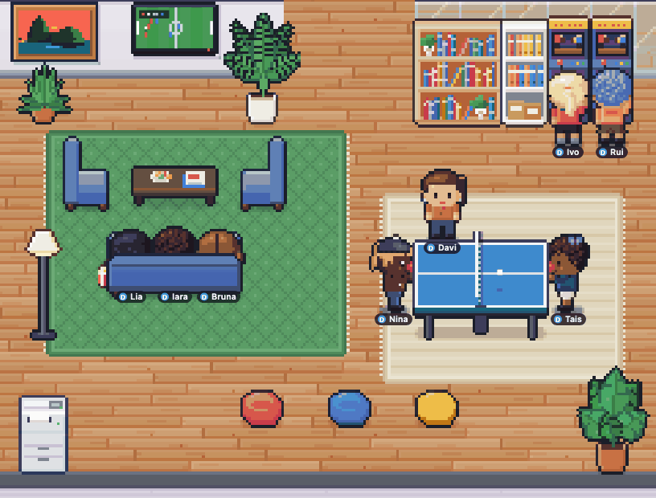
</p>

### Las rondas

| | Ronda | Qué pasa |
| --- | --- | --- |
| 📺 | **TV en el salón** | Fútbol, telenovela o dibujos animados, con palomitas en el sofá. En el fútbol, el público celebra junto con el "GOL" que parpadea en la pantalla (o lamenta el gol del rival); en la telenovela, corazoncitos y "¡No lo puedo creer! 😱". Quien es de siestas acaba dormido en el sofá. |
| 🎮 | **Videojuegos** | Dos en el sofá con el control, la TV en pantalla dividida (carreras o pelea), al mejor de 3, provocaciones ("¿¡Qué es este lag!?") y público animando. |
| 👾 | **Arcade** | Duelo en las dos máquinas del salón, una sola partida. |
| 🏓 | **Ping-pong** | Hasta 5 puntos, con la pelotita yendo y viniendo, el marcador en los globos ("3 × 2 🏓") y público animando detrás de la mesa. |
| ☕ | **Charla en la cocina** | Cada uno toma un café (o agua) y se sienta a la mesa: chismes con el nombre de los compañeros ("¿Viste el commit de Rafaela? 👀"), chistes (el grupo se ríe a carcajadas), trabajo ("¿Deploy un viernes? 😈") y temas del día y de la hora ("¡Por fin es viernes! 🎉"). |
| 💬 | **Conversación** | Dos compañeros de pie en un rincón de la recepción, la cocina o el salón. |
| ✊ | **Piedra, papel o tijera con apuesta** | "Jo… ken… ¡po!", los gestos aparecen sobre la cabeza, quien gana celebra y las monedas vuelan de uno a otro; quien pierde se enoja y, si es competitivo, pide la revancha. Si empatan, repiten. Quien pasa por ahí puede detenerse a mirar. |
| 💄 | **Espejo del baño** | Labial o peine, con la cara reflejada en el espejo y un brillo al final. Vale solo o en pareja ("¿Me prestas el peine?"). |

<table>
  <tr>
    <td width="50%">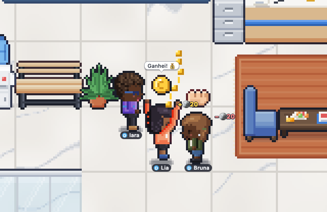</td>
    <td width="50%">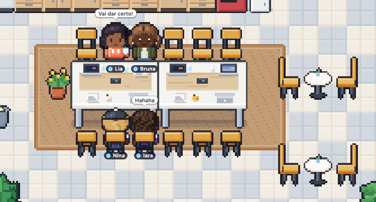</td>
  </tr>
  <tr>
    <td><b>Piedra, papel o tijera por monedas.</b> La apuesta sale de la personalidad (quien es de apuestas apuesta fuerte, quien es tacaño apuesta poco) y nunca supera el saldo de quien tiene menos.</td>
    <td><b>Charla en la cocina.</b> Quien más habla es quien es más sociable; las reacciones dependen del tema (carcajadas con el chiste, 👀 con el chisme).</td>
  </tr>
  <tr>
    <td>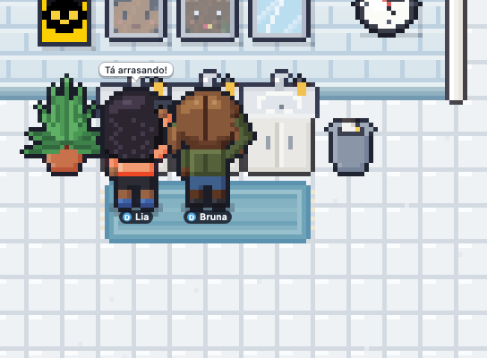</td>
    <td></td>
  </tr>
  <tr>
    <td><b>En el espejo.</b> Quien es de vanidad pasa por el baño siempre que puede, y aparece reflejado.</td>
    <td><b>En los detalles del agente.</b> Qué está haciendo, el monedero, el marcador, la personalidad, las amistades y rivalidades (con el historial) y los movimientos.</td>
  </tr>
</table>

### Personalidades

Cada agente tiene 2 o 3 rasgos, sorteados a partir de su semilla (siempre es la misma persona, en cualquier navegador):

🏆 Competitividad · 🎲 Apuestas · 🎮 Videojuegos · 📺 Series y TV · 🗣️ Chismes · 💄 Vanidad · ☕ Cafeína · 😂 Chistes · 🏓 Deporte ·
🙈 Timidez · 💰 Ahorro · 😴 Siestas · 🧘 Calma · 📚 Lectura

Los rasgos cambian lo que elige cada uno (quien es de series enciende la TV, quien es de deporte invita al ping-pong),
a quién llama (los amigos se buscan; los rivales se desafían en los juegos), qué dice e incluso quién juega mejor. Cada
uno tiene también una muletilla ("¡Hecho!", "¡A programar!"). Pasa el cursor sobre un rasgo en los detalles del agente
para ver qué hace.

### Monedas

Monedas ficticias (🪙), solo para darles gracia a las apuestas:

| | |
| --- | --- |
| **Llegó a la oficina** | 🪙100 (subagentes, 🪙30) |
| **Tarea completada** (elemento de la lista de tareas) | +🪙10 |
| **Solicitud atendida** (fin de turno) | +🪙5 |
| **El subagente entregó el resultado** | +🪙15 |
| **Apuestas** (piedra, papel o tijera; partidas entre rivales o con quien es de apuestas) | lo que pierde uno va para quien gana |

Cada ganancia aparece como "+🪙10" sobre la cabeza; las partidas y apuestas entran en el feed de actividad. El saldo,
el marcador y los movimientos quedan guardados en el navegador (cada navegador tiene su propia economía: las apuestas
se sortean ahí) y se olvidan tres días después de que el agente se va.

> Todo esto es teatro de Habblaud: nada cambia en los agentes de Claude Code, que siguen trabajando con normalidad.

---

<p align="center">
  Hecho con ☕ y muchos agentes de <a href="https://code.claude.com">Claude Code</a>.
</p>
